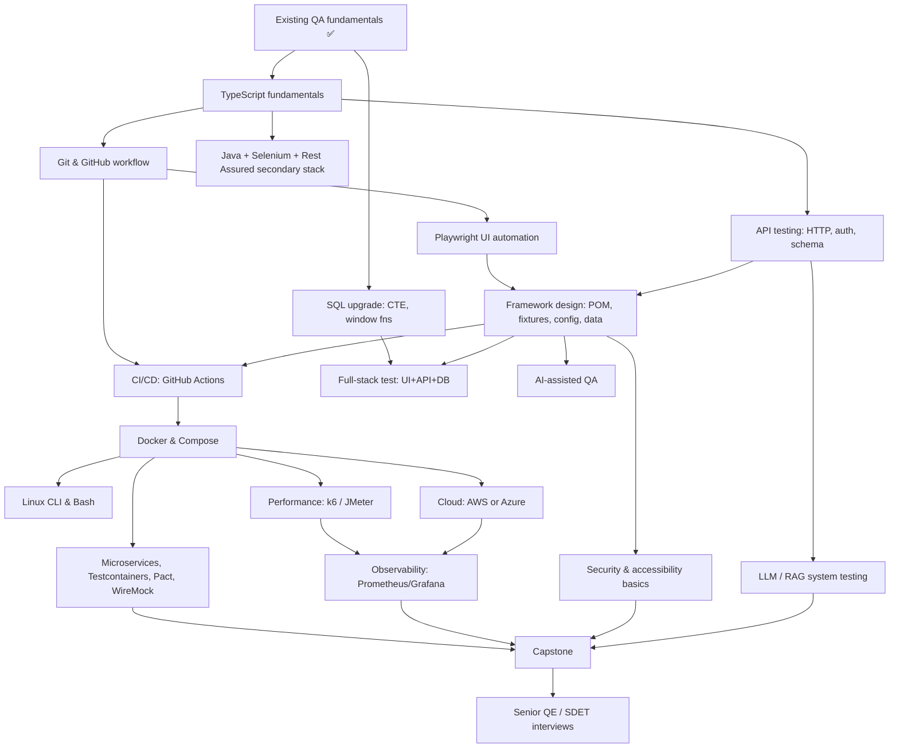
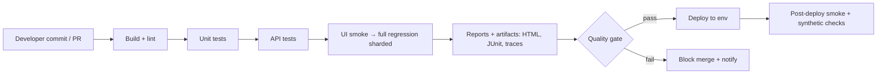
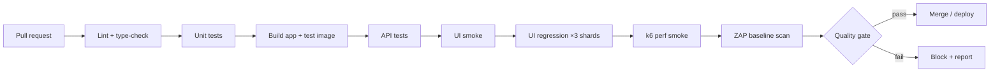
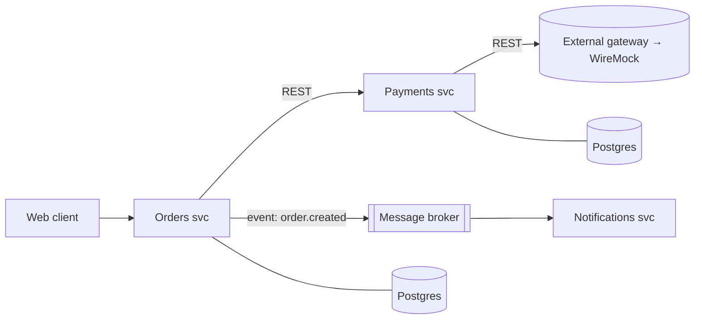
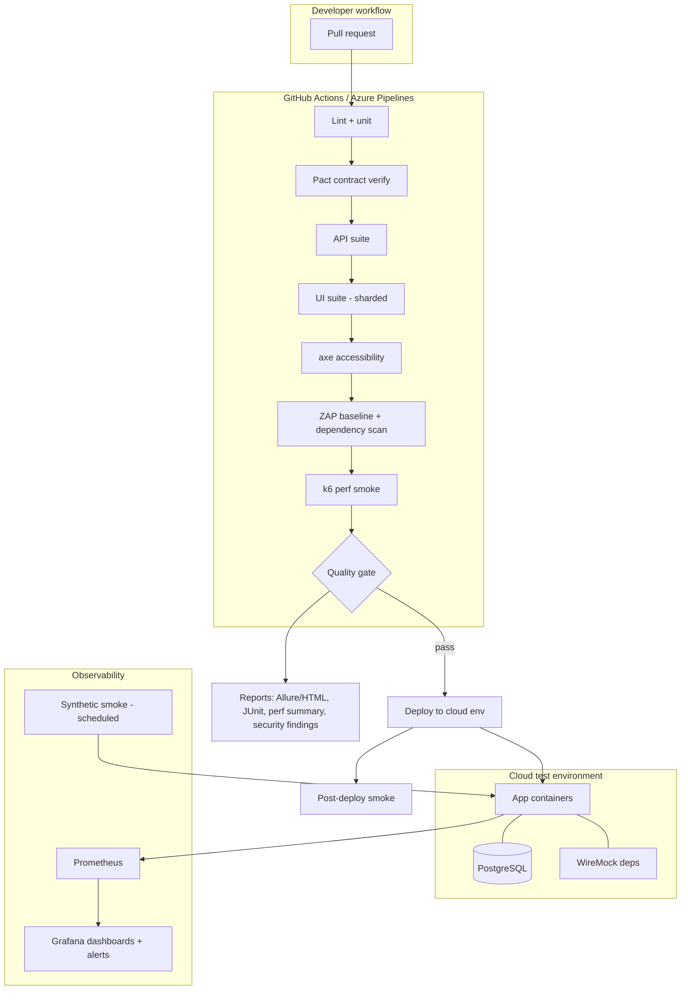
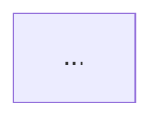
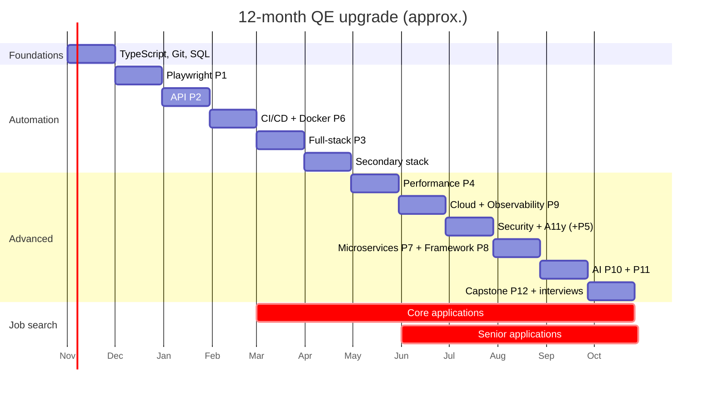

# 🧪 Software Quality Engineer — Australia Job-Ready Roadmap

> **Personal career operating manual** for upgrading 4–5 years of QA experience into a modern, automation-focused **Senior QA / Quality Engineer / SDET** profile that competes for Australian roles.
>
> **Prepared:** October 2026 · **Market evidence window:** ads observed mid-2025 → Oct 2026 · **Review cadence:** re-run the job-ad analysis every 3 months (see [§16](#16-keeping-this-roadmap-current)).

---

## 📌 How to read this document (evidence rules)

This roadmap separates three kinds of statements. Hold it to that standard when you update it.

| Label | Meaning |
|---|---|
| **[Ad evidence]** | Seen in a real Australian job ad or employer careers page during research. Source linked in [Appendix A](#appendix-a--job-ad-sources). |
| **[Inferred]** | My judgement from patterns across ads — reasonable but not counted. |
| **[General]** | General industry knowledge, not specific to the Australian ads reviewed. |

**Limitations — read before trusting any frequency label:**
- I reviewed roughly 30 Australian ads/listings in detail plus SEEK search-result summaries. That is a **qualitative sample, not a statistical survey**. No percentages are given because they would be invented.
- SEEK blocks automated page fetching, so many SEEK ads were read as search-result summaries (title + 1–2 lines), not full descriptions.
- Some listings are from 2025; dates are noted where known.
- **Your current stack is unknown.** Wherever the plan depends on it, an **⚠️ Assumption** box tells you how to adjust.

---

## 📚 Table of Contents

1. [Australian Job Market Analysis](#1-australian-job-market-analysis)
2. [Your Starting Point — What You Probably Already Have](#2-your-starting-point)
3. [Strategic Decisions: Primary / Secondary / Conceptual](#3-strategic-decisions-avoid-overlearning)
4. [Learning Dependency Graph](#4-learning-dependency-graph)
5. [Skill Tiers 1–5 (what to learn, how deep)](#5-skill-tiers)
6. [AI in Software Testing](#6-ai-in-software-testing)
7. [Learning Resources (verified where stated)](#7-learning-resources)
8. [Hands-On Project Roadmap (12 projects)](#8-hands-on-project-roadmap)
9. [Portfolio / GitHub Strategy + README template](#9-portfolio--github-strategy)
10. [CV / Resume Strategy](#10-cv--resume-strategy)
11. [Australian Job Search Strategy](#11-australian-job-search-strategy)
12. [Interview Preparation](#12-interview-preparation)
13. [Certifications](#13-certifications)
14. [12-Month Roadmap + Weekly Plan](#14-12-month-roadmap)
15. [Progress Checklists + "Am I Job-Ready?" Tests](#15-progress-tracking)
16. [Keeping This Roadmap Current](#16-keeping-this-roadmap-current)
17. [Final Recommended Stack](#17-final-recommended-stack)
- [Appendix A — Job Ad Sources](#appendix-a--job-ad-sources)

---

## 1. Australian Job Market Analysis

### 1.1 Market size signals (SEEK keyword search counts, Oct 2026)

These are SEEK result counts for keyword searches — they include loosely matching roles, so treat them as **relative volume signals**, not job counts. [Ad evidence: A1–A5]

| SEEK search | Approx. results shown |
|---|---|
| "QA Engineer" | ~3,066 |
| "QA Automation Engineer" | ~1,021 |
| "Test Automation Engineer" | ~717 |
| "Automation QA" | ~715 |
| "Software QA Engineer" | ~292 |

**Takeaway [Inferred]:** "QA Engineer" and "Quality Engineer" are the umbrella titles. Automation is embedded in most of them rather than living only in "Automation Engineer" titles.

### 1.2 What the ads actually look like — five archetypes

Reading across sectors, Australian QA ads cluster into five recognisable profiles. Knowing which one you're applying to matters more than any single tool.

| Archetype | Typical employers | Typical stack in ads | Evidence |
|---|---|---|---|
| **A. Product / Digital Quality Engineer** | SaaS, airlines, health-tech, media, fintech | Playwright or Cypress, **TypeScript/JavaScript**, GitHub Actions, AWS, Jira | Qantas QE lists Playwright/Cypress, Appium/XCUITest/Espresso, GitHub Actions, AWS, JS/TS/Kotlin/Swift [A20]; Sydney "Test Automation Engineer (Playwright/TypeScript)" up to $140K [A8] |
| **B. Banking / Financial Services Automation** | Big 4 banks, Macquarie, RBA, ASX, payments | **Java**, Selenium, Rest Assured, Cucumber, Karate, Postman; Jenkins/Bamboo; increasingly Playwright | RBA "Selenium-Java"; ASX "SQL, CI/CD, test automation frameworks"; Java + Selenium + Cucumber + Postman [A12]; Macquarie: Rest Assured, Postman, SoapUI, Karate, Playwright, WebdriverIO [A23] |
| **C. Government / Defence (mostly Canberra)** | Federal departments via recruiters/consultancies | **Azure DevOps** (test plans + pipelines), Selenium (often C#), **Tosca**, accessibility; **security clearance + citizenship** | Senior Test Analyst: Azure DevOps, 5+ yrs, Baseline clearance, citizenship [A9]; Senior Automation Test Analyst: Selenium/Katalon/ACCELQ, Azure DevOps CI, accessibility & performance, NV1 [A10]; Selenium + C# + Azure DevOps [A11] |
| **D. Enterprise / Consulting packaged-app testing** | Consultancies, utilities, ERP/CRM programs | **Tricentis Tosca**, Salesforce/SAP testing, Provar | Tosca roles in Melbourne/Sydney [A1][A5][A6]; Qantas QE–Salesforce: Provar, Selenium, UFT, WebdriverIO [A20b] |
| **E. Performance Engineering** | Deloitte, Capgemini, banks | **JMeter, LoadRunner**, Gatling, **k6** (often "strong advantage"), Dynatrace/Splunk/New Relic, CI integration | Deloitte AU [A17]; Capgemini Melbourne [A16]; Sydney Performance Test Lead [A18] |

**Emerging overlay across all five:** AI-enabled QA. Westpac's Lead QA Engineer ad asks for experience with AI tools such as **GitHub Copilot and Claude** [A19]; SEEK shows "Senior QA Engineer – AI" contracts at $1,000–1,300/day [A2] and an enterprise AI-testing lead role using Playwright and Python across LLMs [A26].

### 1.3 Skill frequency table (qualitative)

Labels reflect how often a skill appeared across the ~30 ads reviewed. **No percentages — the sample doesn't support them.**

| Skill | Frequency | Evidence (examples) | Priority |
|---|---|---|---|
| Test automation (any tool) | **Very common** | Nearly every QA/QE ad reviewed | **Core** |
| API testing (REST) | **Very common** | Utilities contract "must have strong API and automation" [A4]; Medibank Postman/SoapUI [A13]; Macquarie [A23] | **Core** |
| CI/CD integration of tests | **Very common** | Qantas, Macquarie, Deloitte, government Azure pipelines [A10][A20][A23] | **Core** |
| Agile/Scrum ways of working | **Very common** | Most ads | **Core** (you likely have it) |
| Playwright | **Common & growing** | Many Sydney/Melbourne ads; "Swap Selenium for Playwright in this Health-Tech role" [A7] | **Core** |
| Selenium WebDriver | **Common** (strong in banking/gov) | RBA, TCS, gov, Reapit [A12][A13][A14][A10] | **High** (secondary) |
| TypeScript / JavaScript | **Common** (product companies) | [A3][A7][A8][A20] | **Core** (primary language) |
| Java | **Common** (banking/enterprise) | [A12][A15]; "Must have great Java coding and Auto testing in Selenium & Playwright" [A7] | **High** (secondary language) |
| SQL / backend data validation | **Common** | ASX, Reapit, Centelon [A12][A13] | **Core** |
| Jira (+ Confluence) | **Common** | Qantas, Reapit [A13][A20] | **Core** (you likely have it) |
| Postman | **Common** | [A12][A13][A23] | **Core** |
| Rest Assured | **Moderately common** (Java shops) | "Rest Assured API testing is must" [A15]; Macquarie [A23] | **High** if targeting banks |
| Cypress | **Moderately common** | Tes QA Engineer, QA Lead roles [A2][A4] | Conceptual |
| BDD / Cucumber | **Moderately common** | [A12][A21]; Playwright + Cucumber BDD analyst [A7b] | Important |
| Azure DevOps | **Common in government** | [A9][A10][A11] | High for gov targets |
| GitHub Actions | **Moderately common** | Qantas [A20] | High (best for portfolio) |
| Jenkins / Bamboo / Bitbucket | **Moderately common** (banks) | [A18][A24] | Secondary |
| AWS | **Moderately common** | Qantas, Reapit [A13][A20] | Important |
| Azure (cloud) | **Moderately common** (gov) | [A9][A25] | Important for gov |
| Docker / containers | **Moderately common** | Qantas "container technologies" [A22]; Macquarie containerised execution [A23] | Important |
| Tricentis Tosca | **Moderately common** (enterprise/gov niche) | [A1][A5][A6][A11] | Optional (sector-specific) |
| Karate | **Emerging/niche** | Macquarie [A23][A24]; Deloitte perf role [A17] | Useful |
| Performance (JMeter/LoadRunner/Gatling/k6) | **Common in perf roles; "highly regarded" in QE roles** | [A16][A17][A18][A23] | Important |
| APM/observability (Dynatrace, Splunk, New Relic) | **Common in perf roles** | [A16][A17][A18] | Useful |
| Mobile automation (Appium, XCUITest, Espresso) | **Moderately common** | Qantas [A20][A22]; Appium-Java lead [A12] | Optional unless targeting mobile |
| Accessibility (WCAG) | **Emerging; notable in government** | Gov automation role weights accessibility equally [A10] | Important for gov |
| Security testing | **Niche in QA ads** (separate pentest roles exist) | Mostly as "reliability, performance, and security" wording [A20]; pentest roles separate [A11] | Awareness |
| Visual testing (Applitools) | **Niche** | Macquarie Senior QE [A24] | Useful |
| Kafka / event-driven testing | **Niche** | Melbourne Kafka tester contract [A27] | Niche |
| AI-assisted testing (Copilot, Claude, MCP) | **Emerging, growing fast** | Westpac [A19]; "innovate with ACE/Copilot" [A7] | High (differentiator) |
| LLM / AI system testing | **Emerging** | [A2][A26]; Qantas Conversational AI QE [A20c] | Useful → High by 2027 [Inferred] |
| ISTQB Foundation | **Occasional; essential in some gov roles** | Canberra Tester role lists it as essential [A25] | Optional (see §13) |
| Security clearance (Baseline/NV1/NV2) | **Common in Canberra** | [A9][A10][A11] | Eligibility gate |

### 1.4 Category answers (concise)

| Category | Most requested (from sample) | Notes |
|---|---|---|
| Programming languages | TypeScript/JavaScript ≈ Java > C# > Python | TS dominates product cos; Java dominates banks; C# in Azure/gov; Python shows up in AI-testing roles [A26] |
| UI automation | Playwright, Selenium > Cypress > Tosca, WebdriverIO | |
| API tools | Postman, Rest Assured, Playwright API > SoapUI, Karate | SOAP still appears via SoapUI in financial ads [A13][A23] |
| Databases | "SQL" generically | Specific engines (Oracle, SQL Server, Postgres) rarely named in QA ads [Inferred]. Learn ANSI SQL well; use PostgreSQL to practise |
| CI/CD | Azure DevOps (gov), Jenkins/Bamboo (banks), GitHub Actions (product), GitLab | |
| Cloud | AWS (product/airline/fintech) and Azure (gov, Microsoft shops) — roughly split by sector | GCP rare |
| Test management | Jira + Zephyr/Xray; Azure Test Plans (gov) | TestRail/qTest seen less [Inferred] |
| Performance | JMeter, LoadRunner, Gatling; k6 rising | Workload modelling + NFRs are requested, not just scripting [A18] |
| Security | OWASP awareness; separate pentest roles | Normal QA ≠ pentester |
| Mobile | Appium; native XCUITest/Espresso at Qantas | |
| Soft skills | Stakeholder comms, release readiness/go-no-go, mentoring, collaboration in squads | Reapit asks to communicate quality health and release readiness to non-technical stakeholders [A13] |
| Experience | Mid: 3–5 yrs; Senior: 5–6+ yrs | Senior Test Analyst 5+ yrs [A9]; Qantas Senior QE 6+ yrs [A22] |
| Education | Rarely mandatory; degree "or equivalent" common [Inferred] | |
| Work rights | Full Australian working rights frequently stated; **citizenship** for gov | [A9][A25][A27] |

### 1.5 Salary/rate signals seen (not a salary survey)

| Role (as advertised) | Signal | Source |
|---|---|---|
| Senior QA Engineer, Sydney (permanent) | $120K–$140K | [A3] |
| Test Automation Engineer (Playwright/TS), Sydney, max-term | up to $140K inc super | [A8] |
| Automation QA Engineer (Tosca), Sydney | $100K–$115K + super | [A5] |
| QA Engineer / AI focus, Melbourne | $115K + super | [A3] |
| QE Lead (Salesforce/Genesys/Playwright), Melbourne | $140K–$150K + super | [A7] |
| Automation Test Engineer contract, Sydney | $750–$800/day inc super | [A4] |
| Senior QA Engineer – AI contract, Sydney | $1,000–$1,300/day inc super | [A2] |
| Senior Test Analyst, Canberra (Baseline) | $110–$125/hr | [A9] |

**[Inferred] signal:** AI + automation and lead-level framework ownership attract the top rates. Pure Tosca and manual-heavy roles sit lower.

---

## 2. Your Starting Point

> ⚠️ **Assumption:** You have 4–5 years of professional QA; your exact tools are unknown. Score yourself honestly below — it decides where you skip ahead.

### 2.1 Self-assessment grid (fill in)

| Area | What you probably already have [Inferred] | Score 0–3 | Action |
|---|---|---|---|
| Testing fundamentals (STLC, test design, defect lifecycle, regression, exploratory, risk-based) | Strong | ☐ | **Skip** study; prepare to *articulate* it at senior level (§12) |
| Agile/Scrum, Jira, Confluence | Strong | ☐ | Skip; learn Xray/Zephyr features in 1 evening |
| Writing test cases/plans | Strong | ☐ | Upgrade to *test strategy* writing (§5 Tier 4) |
| SQL | Basic–intermediate | ☐ | Upgrade to CTEs, window functions, data reconciliation |
| Programming | Varies widely | ☐ | **Biggest lever** — see §3 |
| UI automation | Varies | ☐ | Move to Playwright + framework design |
| API testing | Postman manual testing likely | ☐ | Upgrade to coded API automation + schema/contract |
| CI/CD | Usually "tests run in someone else's pipeline" | ☐ | Build pipelines yourself |
| Docker/Linux/cloud | Often low | ☐ | Learn to "comfortable user" level |
| Performance/security | Often exposure only | ☐ | One solid project each |

**Scoring:** 0 = never used · 1 = used with help · 2 = do independently · 3 = could teach/design it.
**Rule:** anything scored 2–3 → skim checklist in §15 and move on. Don't relearn beginner material.

### 2.2 The gap that matters

Australian senior QE ads repeatedly ask for **framework design + CI integration + strategy + mentoring** (e.g., Macquarie asks Senior QEs to mentor other QEs, identify quality risks and report quality metrics [A23]; government asks for frameworks built from scratch [A10]). Manual-test experience is the foundation; the upgrade is **engineering ownership**.

---

## 3. Strategic Decisions (avoid overlearning)

### 3.1 Primary language: **TypeScript** (secondary: **Java**)

**Why TypeScript first [Ad evidence + Inferred]:**
1. Playwright + TypeScript is the most repeated pairing in current Sydney/Melbourne automation ads [A3][A7][A8][A20].
2. One language covers UI (Playwright), API (Playwright `request`), contract tests (Pact JS), performance (k6 uses JavaScript), and LLM evaluation (promptfoo config/JS). That's fewer context switches.
3. Product companies (Archetype A) are the most "engineering-forward" employers and the strongest SDET path.

**Why Java second:** banking/financial services (Archetype B) still ask for Java + Selenium + Rest Assured [A12][A15], and some ads ask for both Selenium and Playwright in Java [A7].

> ⚠️ **Decision rule (adjust to your history):**
> - If your last 2–3 years were **Java/Selenium** and you're targeting **banks** → make **Java primary**, TS secondary. Your existing experience is worth more than a market trend.
> - If you're targeting **Canberra government / Microsoft shops** → add **C#** awareness and Azure DevOps; Selenium C# appears there [A11].
> - **Python:** keep it as *reading-level / scripting* unless you target AI-testing roles, where Python appears [A26]. Projects 10–11 can be done in TypeScript with promptfoo; Python (DeepEval/Ragas) is the optional stretch.

### 3.2 Primary / Secondary / Conceptual matrix

| Area | 🟢 Primary (build depth) | 🟡 Secondary (working familiarity) | ⚪ Conceptual (can discuss) |
|---|---|---|---|
| Language | TypeScript | Java | Python, C# |
| UI automation | Playwright | Selenium WebDriver (Java) | Cypress, WebdriverIO, Tosca |
| API | Playwright API + Postman/Newman | Rest Assured | Karate, SoapUI |
| Test runner | Playwright Test | JUnit 5 / TestNG | pytest |
| BDD | — (optional Gherkin layer) | Cucumber | SpecFlow/Reqnroll |
| CI/CD | GitHub Actions | Jenkins **or** Azure DevOps (pick by target sector) | GitLab CI, Bamboo |
| Cloud | AWS (or Azure if gov) | the other one at fundamentals level | GCP |
| Containers | Docker + Compose | Testcontainers | Kubernetes basics |
| Performance | k6 | JMeter | LoadRunner, Gatling |
| Observability | Grafana + Prometheus (portfolio) | — | Dynatrace, Splunk, New Relic |
| Security | OWASP Top 10 + ZAP baseline scan | Burp Suite (Community) basics | SAST/SCA (SonarQube, Snyk) |
| Mobile | — | Appium basics | XCUITest, Espresso |
| Contract testing | Pact | WireMock | Spring Cloud Contract |
| Test mgmt | Jira + Xray/Zephyr | Azure Test Plans | TestRail, qTest |
| AI | AI-assisted authoring (Copilot/Claude/Playwright MCP) + promptfoo evals | DeepEval/Ragas | Commercial AI test tools |

**You do NOT need to:**
- Master Selenium **and** Cypress **and** Playwright equally.
- Master Java **and** Python **and** TypeScript **and** C#.
- Learn AWS **and** Azure **and** GCP deeply.
- Learn Jenkins **and** GitHub Actions **and** GitLab CI **and** Azure DevOps deeply — pipeline concepts transfer; YAML syntax is learnable in a day.
- Learn Tosca unless you target enterprise/government Tosca roles (it's licensed and sector-specific).

---

## 4. Learning Dependency Graph



**Critical path:** TypeScript → Git → Playwright + API → framework design → CI/CD → Docker. Everything else hangs off that spine.

---

## 5. Skill Tiers

Depth key: **D3** = design/teach · **D2** = independent hands-on · **D1** = working familiarity · **D0** = conceptual/can discuss.

### TIER 1 — Core Job-Ready Skills

#### 1.1 Software Testing Fundamentals — *Target D3 (articulate, don't relearn)*
You almost certainly know SDLC/STLC, test design, defect lifecycle, regression/smoke/sanity, exploratory and risk-based testing. **What changes at senior level:** explaining *why* you chose a technique, and tying coverage to business risk.

Upgrade items:
- Write a 2-page **test strategy** (not a test plan) for a real-world-style system.
- Practise **requirements traceability** in Jira/Xray (story → test → defect → release).
- Be able to whiteboard BVA, equivalence partitioning, decision tables, state transition, pairwise in < 5 minutes each.

#### 1.2 Programming (TypeScript primary) — *Target D2+*
- Types, interfaces, generics (enough for typed page objects/fixtures and API models)
- async/await and Promises (the #1 source of Playwright bugs)
- Modules, classes, composition vs inheritance
- Error handling, custom errors
- Array/object manipulation (map/filter/reduce), JSON handling
- npm, `package.json`, scripts, linting (ESLint) and formatting (Prettier)
- Unit testing your own utilities (Vitest or Jest)
- **Interview-level:** OOP principles, common data structures, simple algorithm problems (strings, arrays, hash maps)

Secondary (Java, D1→D2): OOP, collections, streams, Maven/Gradle, JUnit 5/TestNG, Selenium WebDriver, Rest Assured.

#### 1.3 Test Automation (Playwright primary) — *Target D3*

| Topic | Depth | Notes |
|---|---|---|
| Locators (role-based, test ids), auto-waiting, web-first assertions | D3 | Core flake-prevention knowledge |
| Page Object Model (and when *not* to use it) | D3 | Also: component objects, screenplay as concept |
| Fixtures (built-in + custom), global setup/teardown | D3 | Playwright's main framework-design lever |
| Auth: storageState, per-role sessions | D3 | |
| Data-driven tests, test data factories | D2 | |
| Parallelism, sharding, workers, test isolation | D2 | |
| Reporting: HTML, Allure, JUnit XML for CI | D2 | |
| Trace viewer, screenshots, video on failure | D2 | |
| Network interception/mocking | D2 | |
| Tagging (`@smoke`, `@regression`), projects, config per env | D2 | |
| Retries vs real fixes; flaky test quarantine | D3 | Senior interview topic |
| BDD/Gherkin layer (Cucumber) | D1 | Asked in banking/Qantas [A12][A21] |
| Keyword-driven | D0 | Mostly Tosca/Robot Framework context |
| Selenium WebDriver + Grid (Java) | D1→D2 | Secondary stack |
| Cypress | D0 | Be able to compare architectures |
| Appium | D0→D1 | Only if targeting mobile |

#### 1.4 API Testing — *Target D3 (major skill)*
- HTTP semantics: methods, idempotency, status codes, headers, caching, content negotiation
- REST design conventions; SOAP/XML basics (still appears via SoapUI in financial ads [A13][A23])
- Auth: API keys, Basic, **OAuth2 flows** (client credentials, auth code + PKCE), **JWT** structure/validation
- JSON Schema validation (Ajv in TS; json-schema-validator in Java)
- Negative, boundary, and authorisation testing (IDOR/BOLA)
- Data-driven API tests, chaining requests, cleanup
- Mocking: WireMock, Playwright route mocking, MSW
- Contract testing: Pact (consumer-driven)
- Tools: **Postman + Newman** (primary manual/collection), **Playwright `request`** (primary coded), **Rest Assured** (secondary)

#### 1.5 SQL / Database Testing — *Target D2*
- SELECT, JOINs (inner/left/anti-join patterns), GROUP BY/HAVING, subqueries
- **CTEs** and **window functions** (ROW_NUMBER, RANK, LAG/LEAD, running totals)
- Data validation & reconciliation queries (source vs target counts, checksums, orphans, duplicates)
- Transactions, isolation basics, constraints
- Stored procedures (read + test them), views
- Migration/ETL testing patterns
- **Practise engine:** PostgreSQL. **[Inferred]** Australian QA ads mostly say "SQL" without naming an engine, so ANSI skill transfers; note SQL Server/T-SQL appears in government/Azure contexts [A11 search summary].

### TIER 2 — Modern QA Engineering

#### 2.1 Git — *D2*
Branching (trunk-based vs GitFlow), PRs, code review etiquette, rebase vs merge, resolving conflicts, `.gitignore`, tags/releases, hooks (Husky + lint-staged for test code). GitHub primary; Bitbucket appears in bank pipelines [A24].

#### 2.2 CI/CD — *D2 in GitHub Actions; D1 in Jenkins or Azure DevOps*



Learn: triggers, matrices, caching, secrets, artifacts, environments/approvals, scheduled runs, sharding, publishing JUnit results, required status checks.
**Which tool [Ad evidence]:** Azure DevOps for government [A9][A10]; Jenkins/Bamboo/Bitbucket in banks [A24]; GitHub Actions in product companies [A20]; GitLab appears in perf roles [A18].

#### 2.3 Docker — *D2*
Images vs containers, Dockerfile, layers, volumes, env vars, networks, Docker Compose for app + DB + tests, official Playwright Docker image, Selenium Grid in Compose, Testcontainers (programmatic containers in tests), running containers in CI.

#### 2.4 Linux — *D1→D2*
Navigation, permissions, processes (`ps`, `top`, `kill`), logs (`tail -f`, `grep`, `less`, `journalctl`), networking (`curl`, `ping`, `dig`, `ss`/`netstat`), SSH + keys, env vars, package managers, small Bash scripts (loops, exit codes, `set -euo pipefail`).

#### 2.5 Cloud — *D1→D2 in one provider*
**Choice [Ad evidence + Inferred]:** AWS for product/airline/fintech targets (Qantas, Reapit list AWS [A13][A20]); Azure for government/Microsoft shops [A9][A25]. Macquarie lists AWS, GCP *or* Azure plus containerising test execution [A23] — concepts matter more than vendor.

| AWS (if primary) | Azure (if primary) |
|---|---|
| IAM (users, roles, least privilege) | Azure DevOps: Boards, Repos, **Pipelines**, **Test Plans** |
| EC2, S3, CloudWatch (logs/metrics) | App Service, Azure Monitor/App Insights |
| Lambda basics | Azure Functions basics |
| ECS/Fargate basics (run test containers) | Container Apps / ACI basics |
| Ephemeral test environments concept | Entra ID basics |

### TIER 3 — Advanced QA Engineering

#### 3.1 Performance Testing — *D2 in k6; D1 in JMeter*
- Types: load, stress, spike, soak/endurance, scalability, baseline
- Metrics: throughput, latency, **percentiles (p90/p95/p99)**, error rate, concurrency vs arrival rate, Little's Law
- **Workload modelling & NFRs** — explicitly requested in Australian perf ads [A18]
- Bottleneck analysis with APM (Dynatrace/New Relic/Splunk appear repeatedly [A16][A17][A18])
- Tools: JMeter and LoadRunner appear most; k6 called a "strong advantage" [A18]; Gatling primary in one Sydney ad [A18b]

> **Why k6 primary despite JMeter frequency?** k6 is JavaScript (same language as your stack), CI-friendly, and integrates with Grafana. Learn JMeter to D1 so you can say yes to JMeter ads. If you target **dedicated performance engineer** roles, flip: JMeter + LoadRunner primary. [Inferred]

#### 3.2 Security Testing — *D1 (awareness + one practical project)*
- OWASP Top 10 (web) and OWASP API Security Top 10
- AuthN/AuthZ testing, session management, input validation, SQLi/XSS/CSRF concepts, security headers, sensitive data exposure
- Dependency scanning (npm audit/Dependabot/Snyk), SAST concept (SonarQube)
- **OWASP ZAP baseline scan in CI** (most realistic QA-level task)
- Burp Suite Community basics (proxy, repeater)

**How much does a normal QA need? [Inferred]** Australian QA ads mention security mainly as a quality attribute; penetration testing appears as **separate** roles (e.g., Canberra pentest contracts [A11 summary]). Target: recognise vulnerabilities, write authorisation tests, run automated scans, escalate. You are not expected to exploit systems.

#### 3.3 Mobile Testing — *Optional (D0→D1)*
Demand exists (Qantas QE asks for mobile automation and native XCUI/Espresso for senior [A20][A22]; Appium-Java lead roles [A12]), but it's **sector-specific**. Learn Appium concepts + BrowserStack/Sauce device clouds. Go deep only if you target airlines, banking apps, retail apps.

#### 3.4 Test Management — *D1 (likely already have)*
Jira + **Zephyr** (Qantas [A21]) or **Xray**; **Azure Test Plans** (government [A9]). TestRail/qTest appear less in this sample [Inferred].

#### 3.5 Agile/Scrum — *Already have; reframe*
Senior framing: three amigos, acceptance criteria quality, Definition of Done including automation, shift-left (testability in refinement) and shift-right (monitoring, feature flags, canary checks).

### TIER 4 — Senior QA Engineering (what separates you)

| Capability | Junior/mid evidence | **Senior evidence (show this)** |
|---|---|---|
| Test strategy | Executes the plan | Writes the strategy; ties scope to risk; says what *not* to test |
| Automation architecture | Writes tests in a framework | Designs the framework; layers; conventions; review standards |
| Test pyramid/quadrants | Knows the diagram | Moves tests down the pyramid; negotiates unit/contract coverage with devs |
| Flakiness | Adds retries | Measures flake rate, root-causes, quarantines, fixes systemic causes |
| Quality gates | Runs pipeline | Defines gate criteria (pass rate, coverage of critical paths, perf budgets, zero critical vulns) |
| Environments & data | Uses what exists | Designs env strategy (ephemeral envs, mocks, seeded data, synthetic data, PII-safe) |
| Metrics | Reports pass/fail | Uses DORA-adjacent and quality metrics: escaped defects, MTTR, change-fail rate, cycle time, automation ROI |
| Defects | Logs bugs | Leads RCA; drives prevention (contract tests, lint rules, testability changes) |
| Release | Signs off tests | Presents risk-based release recommendation; go/no-go [A20] |
| Production | Tests pre-prod | Uses observability, synthetic monitoring, feature flags |
| People | Asks for help | Mentors, reviews test code, upskills devs/BAs — explicitly asked in Macquarie & Westpac ads [A19][A23] |
| Stakeholders | Reports status | Communicates quality health to non-technical stakeholders [A13] |

**What you must demonstrate in senior interviews:** (1) a framework you designed with explicit trade-offs, (2) a strategy you wrote for a risky change, (3) a measurable improvement you drove, (4) how you influenced developers/leaders without authority, (5) how you handled a production incident.

### TIER 5 — Specialised / Advanced (classified)

| Topic | Class | Rationale |
|---|---|---|
| Contract testing / Pact | **Important** | Microservices-heavy product & bank teams; strong senior signal [Inferred] |
| Service virtualisation / WireMock | **Important** | Unblocks testing against unavailable dependencies |
| Testcontainers | **Useful** | Modern integration testing; great portfolio signal |
| Microservices testing | **Important** | Service contracts/dependencies appear in QE ads [Inferred from A23, A27] |
| Event-driven / Kafka / message queues | **Niche → Useful** | Seen in Melbourne contract [A27]; valuable in banks/telcos |
| GraphQL testing | **Useful** | Rest Assured course added GraphQL in 2026 (signal of demand) [R-Udemy]; GraphQL not seen as a QA-ad requirement in this sample [Uncertain] |
| WebSocket testing | **Niche** | Trading/real-time apps |
| Accessibility (WCAG 2.2, axe) | **Important** (esp. government) | Gov role weighs accessibility equally with automation [A10] |
| Visual regression | **Useful** | Applitools in Macquarie Senior QE ad [A24] |
| Chaos testing | **Niche** | SRE-adjacent; discuss conceptually |
| Distributed systems testing | **Useful** (senior interviews) | System-design rounds |
| Synthetic monitoring | **Useful** | Shift-right signal |
| AI-assisted testing | **Important** | Westpac, Copilot mentions [A7][A19] |
| AI/LLM/RAG system testing | **Useful → Important** | Emerging AU roles [A2][A26] |

---

## 6. AI in Software Testing

### 6.1 What Australian ads actually ask for (evidence)
- **AI-assisted engineering tools:** Westpac's Lead QA Engineer ad lists experience with AI tools such as GitHub Copilot, Claude, AMP, and a strong understanding of AI-enabled testing [A19]. Another Sydney ad: "integrate CI/CD and innovate with ACE/Copilot" [A7].
- **AI-enabled QA practice:** "Evolve QA practices by evaluating & implementing AI-enabled testing strategies" [A26b]; "reshape the QA team with the integration of AI and automation" [A26b].
- **Testing AI products:** Senior QA Engineer – AI contracts [A2]; an enterprise AI-testing lead across LLMs using Playwright and Python [A26]; Qantas Quality Engineer – Conversational AI [A20c]; Macquarie Senior AI Automation Test Engineer listing [A28].
- **Commercial AI test tools (mabl, Testim, Applitools AI, BrowserStack AI, Tricentis AI):** I did **not** find these named as requirements in the Australian sample, except Applitools (visual testing) [A24] and Tricentis Tosca (as a platform) [A1]. Treat them as **conceptual** until ads change. [Uncertain]

### 6.2 Two distinct skill sets

| A. AI-*assisted* QA (using AI to test faster) | B. Testing AI systems (QA *of* AI) |
|---|---|
| Generating test ideas/cases from stories | Prompt regression testing |
| Drafting Playwright/API tests with Copilot/Claude | RAG evaluation: retrieval quality, faithfulness, answer relevance |
| Playwright MCP / Playwright agents for exploration and generation [General; several 2025–26 courses cover them, R-P3] | Hallucination & grounding tests |
| Failure triage & defect summarisation | Safety/red-team tests: prompt injection, jailbreaks, PII leakage, toxicity |
| Synthetic test data generation | Non-determinism handling: thresholds, LLM-as-judge, golden sets |
| Self-healing locators (concept; know the risks) | Agent testing: tool-call accuracy, goal completion, guardrails |

### 6.3 Tools to know

| Tool | Use | Level |
|---|---|---|
| GitHub Copilot / Claude | Test authoring, refactoring, review | **D2** — named in AU ads [A19] |
| Playwright MCP / agents | AI-driven browser exploration and test generation | D1 |
| **promptfoo** | Prompt/LLM regression + red-teaming, YAML/JS, CI-friendly | **D2** (fits TS stack) |
| DeepEval | pytest-style LLM test metrics; designed as a CI gate | D1 (Python, optional) |
| Ragas | RAG-specific metrics: context precision/recall, faithfulness, response relevancy | D1 (Python, optional) |
| Applitools (Visual AI) | Visual regression | D0–D1 |
| mabl / Testim / Tricentis AI / BrowserStack AI | Commercial AI-augmented testing | D0 (not seen as requirements) |

Source on the eval tools: an independent 2026 comparison describes DeepEval as pytest-based and built to function as a CI/CD gate, and Ragas as RAG-specialised, with teams often running both [R-AI1].

### 6.4 Guardrails you should be able to explain in interviews
- Never paste production data/PII or proprietary code into unapproved AI tools — know your employer's policy.
- AI-generated tests still need review: check assertions are meaningful, not tautological.
- Self-healing hides real UI regressions if unmonitored.
- LLM-as-judge has known biases (position, verbosity, self-preference) — calibrate against human-labelled samples [R-AI1].

---

## 7. Learning Resources

### 7.0 Verification status legend
| Mark | Meaning |
|---|---|
| ✅ | Page found/fetched during this research (Oct 2026); details shown are from that page or a listing of it |
| 🔗 | Official/stable URL from general knowledge; **not re-fetched** this session — click once to confirm |
| 🔎 | Exact URL not verified — search the exact title on the platform |

Ratings/students are shown **only** where seen during research. Udemy numbers change; re-check before buying, and **only buy on sale**.

### 7.1 Paid courses (Udemy and similar)

| Topic | Course | Instructor | Rating | Students / ratings | Last updated | Level | Link | Status |
|---|---|---|---|---|---|---|---|---|
| Playwright (TS/JS) | Playwright JS/TS Automation Testing from Scratch & Framework | Rahul Shetty Academy | 4.6 | 32,039 ratings | not seen | Beginner→Framework | [Udemy Playwright topic](https://www.udemy.com/topic/playwright/) — search title | 🔎 rating ✅ via topic page |
| Playwright (TS) | Playwright: Web Automation Testing From Zero to Hero | Artem Bondar | 4.7 | 3,009 ratings (Class Central listing) | not seen | Beginner→Intermediate; includes fixtures, Docker, env vars | [Class Central listing](https://classcentral.com/course/udemy-playwright-from-zero-to-hero-294867) | ✅ listing |
| Playwright (TS) | Playwright – Complete Beginner Course 2026 (UI + API) | (see page) | 4.6 | 11,787 students / 1,817 ratings | 2026 title | Beginner | [Udemy](https://www.udemy.com/course/playwright-complete-beginner-course/) | ✅ |
| Playwright mentored (paid, non-Udemy) | Playwright UI Testing Mastery (formerly "SDET with Playwright") | Artem Bondar / Bondar Academy | — | — | — | Intermediate; includes GitHub code reviews | [Bondar Academy](https://bondaracademy.learnworlds.com/course/sdet-with-playwright) | ✅ — good if you want PR feedback |
| Postman / API | Postman – Learn API Testing from Scratch with Live Projects | Rahul Shetty Academy | 4.6 | 11,502 ratings | not seen | Beginner→Intermediate | [Udemy Playwright topic](https://www.udemy.com/topic/playwright/) (bundled listing) — search title | 🔎 |
| Rest Assured (Java) | Rest API Testing (Automation) from Scratch – Rest Assured Java | Rahul Shetty Academy | not seen | not seen | Jan 2026 (adds GraphQL) per third-party listing | Beginner→Framework (Cucumber BDD) | Search title on Udemy | 🔎 |
| API (Postman + Rest Assured) | API Testing Masterclass from Scratch (Postman+Rest Assured) | (see page) | 4.4–4.5 | ~2,205 ratings | not seen | Beginner→Intermediate | [Udemy](https://www.udemy.com/course/api-testing-rest-api-automation-testing-from-scratch/) | ✅ |
| Selenium Java | Selenium WebDriver with Java – Basics to Advanced + Frameworks | Rahul Shetty Academy | not verified | not verified | not verified | Beginner→Framework | Search title on Udemy | 🔎 **Only if you need the Java secondary stack** |
| SQL | The Complete SQL Bootcamp | Jose Portilla | not verified | not verified | not verified | Beginner→Intermediate | Search title on Udemy | 🔎 Free alternatives in 7.2 are sufficient |
| Docker | Docker for the Absolute Beginner – Hands On | Mumshad Mannambeth (KodeKloud) | not verified | not verified | not verified | Beginner | Search title on Udemy | 🔎 |
| AWS | Ultimate AWS Certified Cloud Practitioner | Stéphane Maarek | not verified | not verified | not verified | Beginner | Search title on Udemy | 🔎 Only if pursuing the cert |

> **Budget advice [Inferred]:** You need at most **3 paid courses** in year one: one Playwright (pick Bondar *or* Shetty, not both), one API (only if you take the Java path), one cloud (only if certifying). Official docs + projects carry the rest.

### 7.2 Free courses & YouTube

| Topic | Resource | Provider | Level | Duration | Free | Link | Status |
|---|---|---|---|---|---|---|---|
| Playwright advanced | Advanced Playwright (auth optimisation, dynamic POM & fixtures, APIs, data management, visual regression, CI & observability) | Test Automation University — Renata Andrade | Intermediate | ~course | ✅ Free | [Class Central listing](https://classcentral.com/course/tau-playwright-advanced-295202) | ✅ |
| Playwright intro (JS) | Playwright with JavaScript | Test Automation University — Ixchel Meza | Beginner | ~course | ✅ Free | [Applitools blog list](https://applitools.com/blog/7-awesome-test-automation-university-courses-not-to-miss/) | ✅ |
| Observability for automation | Introduction to Observability for Test Automation | Test Automation University | Intermediate | ~course | ✅ Free | same as above | ✅ |
| Playwright tutorials (Python & JS) | Modern Web Testing with Playwright / Awesome Web Testing with Playwright in Python | Andrew Knight (Automation Panda) | Beginner→Int | self-paced | ✅ Free | [Automation Panda teaching page](https://automationpanda.com/teaching/) | ✅ |
| Automation + CI/CD, Karate API | TestGuild free courses (Playwright, DevOps test automation boot camp, Karate API) | TestGuild | Beginner→Int | varies | ✅ Free | [TestGuild training](https://testguild.com/training-courses/) | ✅ |
| PostgreSQL | PostgreSQL full course (~4h) | Amigoscode via freeCodeCamp | Beginner | ~4h | ✅ Free | [freeCodeCamp article](https://www.freecodecamp.org/news/postgresql-full-course/) | ✅ |
| SQL (curated list) | Free SQL courses (freeCodeCamp, Mosh, Traversy, Amigoscode) | freeCodeCamp | Beginner | varies | ✅ Free | [freeCodeCamp list](https://www.freecodecamp.org/news/learn-sql-free-relational-database-courses-for-beginners/) | ✅ |
| SQL + Bash + Git interactive | Relational Database curriculum (VS Code + Docker) | freeCodeCamp | Beginner→Int | long | ✅ Free | [freeCodeCamp guide](https://www.freecodecamp.org/news/how-to-run-freecodecamps-relational-databases-curriculum-using-docker-vscode-and-coderoad/) | ✅ |
| Docker, Kubernetes, GitHub Actions, DevOps | TechWorld with Nana (channel) | Nana Janashia | Beginner→Int | varies | ✅ Free | [YouTube channel](https://www.youtube.com/@TechWorldwithNana) | 🔗 |
| Programming, SQL, Git, cloud | freeCodeCamp (channel) | freeCodeCamp | Beginner→Int | varies | ✅ Free | [YouTube channel](https://www.youtube.com/@freecodecamp) | 🔗 |
| Playwright release videos | Playwright (official channel) | Microsoft Playwright team | All | short | ✅ Free | [YouTube channel](https://www.youtube.com/@Playwrightdev) | 🔗 |
| k6 | Grafana k6 docs + examples | Grafana Labs | Beginner→Int | self-paced | ✅ Free | [k6 docs](https://grafana.com/docs/k6/latest/) | 🔗 |
| OWASP | OWASP Top 10 + API Security Top 10 + Juice Shop (practice app) | OWASP | Beginner→Int | self-paced | ✅ Free | [OWASP Top 10](https://owasp.org/www-project-top-ten/) · [Juice Shop](https://owasp.org/www-project-juice-shop/) | 🔗 |
| Web security labs | Web Security Academy | PortSwigger (Burp Suite makers) | Beginner→Adv | self-paced | ✅ Free | [PortSwigger Academy](https://portswigger.net/web-security) | 🔗 |
| AWS fundamentals | AWS Skill Builder (Cloud Practitioner Essentials) | AWS | Beginner | ~6h | ✅ Free tier | [AWS Skill Builder](https://skillbuilder.aws/) | 🔗 |
| Azure DevOps / Azure | Microsoft Learn paths (Azure Fundamentals, Azure Pipelines) | Microsoft | Beginner | varies | ✅ Free | [Microsoft Learn](https://learn.microsoft.com/training/) | 🔗 |
| Test architecture | The Practical Test Pyramid (article) | Ham Vocke on martinfowler.com | Intermediate | ~1h read | ✅ Free | [martinfowler.com](https://martinfowler.com/articles/practical-test-pyramid.html) | 🔗 |
| LLM evaluation | LLM evaluation frameworks compared (RAGAS vs DeepEval vs Promptfoo) | MachineLearningMastery | Intermediate | ~30 min | ✅ Free | [Article](https://machinelearningmastery.com/llm-evaluation-frameworks-compared-how-to-actually-measure-what-your-model-does/) | ✅ |

> **Not recommended:** Selenium courses built on Selenium 3 / `PageFactory`-heavy Java patterns or `Thread.sleep` waits. If a course shows those, its framework advice is outdated — use Selenium's official docs (Selenium 4, explicit waits, BiDi) instead. [General]

### 7.3 Official documentation (🔗 stable official URLs — not re-fetched this session)

| Tool | Docs |
|---|---|
| Playwright | https://playwright.dev/docs/intro · Best practices: https://playwright.dev/docs/best-practices |
| Selenium | https://www.selenium.dev/documentation/ |
| Cypress | https://docs.cypress.io/ |
| Appium | https://appium.io/docs/en/latest/ |
| Postman | https://learning.postman.com/docs/ |
| Newman | https://github.com/postmanlabs/newman |
| REST Assured | https://rest-assured.io/ |
| pytest | https://docs.pytest.org/ |
| JUnit 5 | https://junit.org/junit5/docs/current/user-guide/ |
| TestNG | https://testng.org/ |
| Git | https://git-scm.com/doc |
| GitHub Docs | https://docs.github.com/ |
| GitHub Actions | https://docs.github.com/actions |
| GitLab CI | https://docs.gitlab.com/ee/ci/ |
| Jenkins | https://www.jenkins.io/doc/ |
| Docker | https://docs.docker.com/ |
| Kubernetes | https://kubernetes.io/docs/home/ |
| AWS | https://docs.aws.amazon.com/ |
| Azure DevOps | https://learn.microsoft.com/azure/devops/ |
| PostgreSQL | https://www.postgresql.org/docs/ |
| OWASP | https://owasp.org/ · ZAP: https://www.zaproxy.org/docs/ |
| JMeter | https://jmeter.apache.org/usermanual/ |
| k6 | https://grafana.com/docs/k6/latest/ |
| BrowserStack | https://www.browserstack.com/docs |
| Pact | https://docs.pact.io/ |
| Testcontainers | https://testcontainers.com/ · Node: https://node.testcontainers.org/ |
| WireMock | https://wiremock.org/docs/ |
| axe-core (a11y) | https://github.com/dequelabs/axe-core |
| promptfoo | https://www.promptfoo.dev/docs/intro/ |
| DeepEval | https://deepeval.com/docs/getting-started |
| Ragas | https://docs.ragas.io/ |
| WCAG 2.2 | https://www.w3.org/TR/WCAG22/ |

### 7.4 Blogs & technical reading (quality over quantity)

| Source | Why | Link | Status |
|---|---|---|---|
| martinfowler.com (testing articles) | Test pyramid, contract testing, test doubles, microservices testing | https://martinfowler.com/testing/ | 🔗 |
| Google Testing Blog | Flakiness, test sizes, "Testing on the Toilet" | https://testing.googleblog.com/ | 🔗 |
| Thoughtworks Technology Radar | What's adopted/trialled in industry (Playwright, Pact, etc.) | https://www.thoughtworks.com/radar | 🔗 |
| Ministry of Testing | Community, Australian meetups, senior-QA thinking | https://www.ministryoftesting.com/ | 🔗 |
| Netflix Tech Blog | Chaos engineering, resilience, observability at scale | https://netflixtechblog.com/ | 🔗 |
| Applitools blog / TAU | Automation courses & visual testing | https://applitools.com/blog/ | ✅ |
| Automation Panda | Pragmatic automation & BDD writing | https://automationpanda.com/ | ✅ |
| TestGuild | Podcasts/interviews with automation leaders | https://testguild.com/ | ✅ |
| Grafana k6 blog | Performance testing practice | https://grafana.com/blog/ | 🔗 |
| Playwright release notes | Keep up with features (agents/MCP etc.) | https://playwright.dev/docs/release-notes | 🔗 |

---

## 8. Hands-On Project Roadmap

### 8.0 Rules for every project
- **System under test:** use public practice apps you're allowed to automate, or build tiny services yourself. Good targets [General]: Restful-Booker (API), OWASP Juice Shop (security/UI), your own Node/Express or Spring Boot service + PostgreSQL in Docker. **Never** load-test or security-scan sites you don't own or have permission for.
- **Every repo** gets: README (template in §9), test strategy, CI badge, reports, "Known limitations".
- **Projects build on each other.** P1→P3→P6→P8 is one evolving framework; don't restart from scratch each time.
- **AI use:** allowed and encouraged — but note in the README which parts were AI-assisted and how you verified them. This is itself a senior signal.

### 8.1 Overview

| # | Project | Difficulty | Est. time (10–12 h/wk) | Primary proof |
|---|---|---|---|---|
| P1 | Playwright UI framework | ★★☆☆☆ | 3–4 wks | Modern UI automation |
| P2 | API automation suite | ★★☆☆☆ | 3 wks | API depth |
| P3 | Full-stack QA (UI+API+DB) | ★★★☆☆ | 4 wks | End-to-end + SQL |
| P4 | Performance testing | ★★★☆☆ | 3 wks | k6/JMeter + analysis |
| P5 | Mobile automation *(optional)* | ★★★☆☆ | 3 wks | Appium |
| P6 | CI/CD quality pipeline | ★★★☆☆ | 3 wks | Pipelines + gates |
| P7 | Microservices testing | ★★★★☆ | 4–5 wks | Contract/integration |
| P8 | Senior automation framework | ★★★★☆ | 4 wks | Framework architecture |
| P9 | Performance + observability | ★★★★☆ | 3 wks | Grafana/Prometheus |
| P10 | AI-assisted QA | ★★★☆☆ | 3 wks | AI in workflow |
| P11 | AI system (RAG) testing | ★★★★☆ | 3–4 wks | LLM evaluation |
| P12 | Capstone | ★★★★★ | 5–6 wks | Everything, cohesively |

---

### P1 — Playwright UI Automation Framework
| Field | Detail |
|---|---|
| **Objective** | Production-style UI suite for a realistic web app (e.g., demo e-commerce / booking app) |
| **Skills** | Locators, POM, fixtures, auth via storageState, data-driven tests, tags, parallelism, traces |
| **Tech** | TypeScript, Playwright Test, ESLint/Prettier, Allure or HTML reporter, GitHub Actions |
| **Architecture** | `tests/` (specs by feature) · `pages/` · `fixtures/` · `data/` · `utils/` · `playwright.config.ts` with projects (chromium/firefox/webkit, mobile viewport) and env config |
| **Test strategy** | Risk-ranked critical journeys (login, search, checkout); smoke vs regression tags; what's intentionally *not* automated |
| **Test cases** | 15–25 meaningful tests: happy paths, validation errors, role-based access, session expiry, cross-browser layout checks |
| **Automation** | Custom fixtures for logged-in pages; test data builders; network mock for a flaky third-party widget |
| **CI/CD** | GitHub Actions on PR: lint → smoke; nightly: full regression sharded ×3; artifacts: report + traces on failure |
| **Reporting** | HTML/Allure report published as artifact (or GitHub Pages); screenshot + video on failure |
| **GitHub deliverables** | Repo, README with architecture diagram, `TEST_STRATEGY.md`, CI badge, sample report screenshot, short demo GIF |
| **CV line** | "Built a TypeScript/Playwright UI framework (POM + custom fixtures) with sharded parallel CI execution and trace-based failure diagnostics." |
| **Interview prep** | Playwright vs Selenium vs Cypress; how auto-wait works; fixtures vs hooks; how you'd structure 500 tests; handling auth |

### P2 — API Automation Suite
| Field | Detail |
|---|---|
| **Objective** | Thorough REST API suite covering functional, negative, auth and schema validation |
| **Skills** | HTTP, OAuth2/JWT, schema validation, data-driven, negative/boundary, chaining, cleanup |
| **Tech** | Postman + Newman (collection, environments, CLI run); Playwright `request` + Ajv (TS). **Optional Java track:** Rest Assured + JUnit 5 |
| **Architecture** | API clients per resource · typed models · schema files · test data factories · env config |
| **Test strategy** | Coverage matrix: endpoint × method × scenario type (happy, validation, auth, authZ, boundary, idempotency) |
| **Test cases** | CRUD flows; 400/401/403/404/409/422 cases; pagination/sorting; malformed JSON; oversized payload; token expiry; IDOR attempt (user A reads user B) |
| **Automation** | Newman for smoke in CI; coded suite for deeper checks; JSON Schema assertions on every response |
| **CI/CD** | Run on PR; JUnit XML published; Newman HTML report |
| **Reporting** | Newman htmlextra report; Playwright report |
| **GitHub deliverables** | Repo, coverage matrix table, Postman collection export, schemas, CI badge |
| **CV line** | "Automated REST API testing across N endpoints including OAuth2/JWT, schema validation and authorisation (IDOR) checks, integrated into CI." *(N from your repo)* |
| **Interview prep** | PUT vs PATCH; idempotency; 401 vs 403; how JWT works; how you'd test rate limiting; contract vs schema testing |

### P3 — Full-Stack QA Project (UI + API + DB)
| Field | Detail |
|---|---|
| **Objective** | Test a small app you run locally (frontend + API + PostgreSQL) at all layers |
| **Skills** | SQL validation, API-seeded UI tests, test data management, layered strategy |
| **Tech** | Docker Compose (app + Postgres), Playwright (UI+API), `pg` client, SQL scripts |
| **Architecture** | Compose stack · seed/reset scripts · tests use API to arrange, UI to act, SQL to assert |
| **Test strategy** | Test pyramid applied: which checks belong at API/DB level vs UI |
| **Test cases** | Order created in UI → row exists with correct status/amount; soft-delete hides record; concurrent update conflict; data migration script validation with reconciliation queries |
| **Automation** | DB helper with parameterised queries; transactional cleanup; data factories |
| **CI/CD** | Compose up in GitHub Actions; run suite; tear down |
| **Reporting** | Combined report; SQL reconciliation output saved as artifact |
| **GitHub deliverables** | Repo, ERD, `SQL_CHECKS.md` with CTE/window-function queries, strategy doc |
| **CV line** | "Designed layered UI/API/DB tests with API-seeded data and SQL reconciliation checks, cutting UI test count in favour of faster API/DB assertions." |
| **Interview prep** | Write a JOIN/CTE live; how you test data migrations; test data isolation in parallel runs |

### P4 — Performance Testing
| Field | Detail |
|---|---|
| **Objective** | Plan, execute and *analyse* load/stress/spike/soak tests against your own API from P3 |
| **Skills** | NFRs, workload model, percentiles, thresholds, bottleneck analysis |
| **Tech** | k6 (primary), JMeter (re-implement one scenario), Docker |
| **Architecture** | Scenarios as code; thresholds (p95 < X ms, errors < Y%); results exported |
| **Test strategy** | Performance test plan: objectives, workload model from assumed traffic, environments, entry/exit criteria, risks |
| **Test cases** | Baseline · load at expected peak · stress to break point · spike · 1-hour soak (watch memory) |
| **Automation** | Short k6 smoke-perf in CI with thresholds; full runs manual/scheduled |
| **CI/CD** | Perf smoke gate on main branch |
| **Reporting** | Results summary with charts; **bottleneck write-up** (e.g., introduce an unindexed query, find it, fix it, re-test) |
| **GitHub deliverables** | Repo, `PERF_TEST_PLAN.md`, `RESULTS.md` with before/after |
| **CV line** | "Defined NFRs and workload models, executed k6/JMeter load and soak tests, and identified a DB indexing bottleneck that improved p95 latency by X% in the test environment." *(X measured by you)* |
| **Interview prep** | Average vs p95; open vs closed workload models; how to find a bottleneck; why soak tests matter |

### P5 — Mobile Automation *(optional — do only if targeting mobile-heavy employers)*
| Field | Detail |
|---|---|
| **Objective** | Automate a sample Android app + its API |
| **Skills** | Appium 2 drivers, capabilities, locators, gestures, emulators, device clouds |
| **Tech** | Appium + WebdriverIO (TS) **or** Appium Java client; Android emulator; BrowserStack/Sauce free trial |
| **Test strategy** | Device/OS matrix by risk; network conditions; offline mode; deep links |
| **Test cases** | Login, form validation, rotation, background/foreground, permission dialogs |
| **CI/CD** | Emulator run in CI (or device cloud) on schedule |
| **CV line** | "Built Appium mobile automation for Android with a device matrix strategy and CI execution." |
| **Interview prep** | Native vs hybrid vs mobile web; why Appium is slower; XCUITest/Espresso vs Appium trade-offs (Qantas asks for native [A22]) |

### P6 — CI/CD Quality Pipeline
| Field | Detail |
|---|---|
| **Objective** | One pipeline that turns P1–P4 into a gated delivery flow |
| **Skills** | Pipeline design, caching, matrices, sharding, secrets, environments, gates |
| **Tech** | GitHub Actions (primary); port the same pipeline to **Jenkins** *or* **Azure DevOps** (choose by target sector) |
| **Architecture** | See diagram below |
| **Test strategy** | Gate policy: what blocks merge vs what only notifies |
| **Automation** | Reusable workflows; Docker-based test runner image |
| **Reporting** | JUnit published to PR checks; HTML report artifact; trend over runs |
| **GitHub deliverables** | `.github/workflows/`, `Jenkinsfile` or `azure-pipelines.yml`, `QUALITY_GATES.md` |
| **CV line** | "Designed a CI quality pipeline (lint → unit → API → sharded UI → perf smoke → security scan) with merge-blocking quality gates in GitHub Actions and Azure DevOps." |
| **Interview prep** | Where tests belong in a pipeline; reducing pipeline time; handling secrets; flaky tests in gates |



### P7 — Microservices Testing
| Field | Detail |
|---|---|
| **Objective** | Build 2–3 tiny services (e.g., orders, payments, notifications) and test their interactions |
| **Skills** | Contract testing, service virtualisation, integration tests, async messaging |
| **Tech** | Node/Express (or Spring Boot), PostgreSQL, RabbitMQ or Kafka (single broker), Docker Compose, **Pact**, **WireMock**, **Testcontainers** |
| **Architecture** | Diagram below |
| **Test strategy** | Unit → contract (Pact) → component (service + Testcontainers DB + WireMock deps) → a *few* E2E |
| **Test cases** | Consumer contract for orders→payments; payment provider timeout via WireMock; message published once & consumed idempotently; poison message handling |
| **CI/CD** | Contract verification step; can-i-deploy check (Pact Broker or PactFlow free tier) |
| **CV line** | "Implemented consumer-driven contract tests (Pact) and Testcontainers-based component tests for a 3-service system, reducing reliance on full E2E environments." |
| **Interview prep** | Why contract tests; testing eventual consistency; idempotency; how to test without a shared env |



### P8 — Senior QA Automation Framework
| Field | Detail |
|---|---|
| **Objective** | Refactor P1–P3 into a framework another team could adopt |
| **Skills** | Architecture, conventions, maintainability, documentation, review standards |
| **Tech** | Playwright TS monorepo (or workspace), typed config (zod), structured logging, custom reporter, ESLint rules for tests |
| **Architecture** | Layers: **tests** → **domain flows** → **page/components & API clients** → **core** (config, logging, data, auth). Env management via typed config; secrets via env vars only |
| **Test strategy** | `FRAMEWORK_DESIGN.md` with ADRs (Architecture Decision Records): why fixtures over inheritance, why API-seeded data, retry policy |
| **Features** | Parallel-safe data; retries **only** with flake tracking; quarantine tag; failure triage report grouping by error signature; contribution guide |
| **CI/CD** | Reusable workflow consumers could call |
| **CV line** | "Architected a reusable Playwright/TypeScript framework (typed config, layered abstractions, flake quarantine, ADR-documented decisions) adopted across N projects." *(N = only real adoption)* |
| **Interview prep** | "Design a framework for a large bank" — this repo **is** your answer |

### P9 — Performance + Observability
| Field | Detail |
|---|---|
| **Objective** | Correlate load with system metrics to diagnose, not just measure |
| **Tech** | k6 → Prometheus remote write (or InfluxDB), Prometheus scraping app metrics, Grafana dashboards, alert rule, Docker Compose |
| **Test cases** | Same scenarios as P4 with dashboards for latency percentiles, RPS, error rate, CPU/mem, DB connections |
| **Deliverables** | Compose stack, exported dashboard JSON, screenshots, `ANALYSIS.md` |
| **CV line** | "Built a performance-observability stack (k6, Prometheus, Grafana) to correlate load with resource metrics and alert on SLO breaches." |
| **Interview prep** | RED/USE methods; SLI/SLO; how APM tools (Dynatrace/New Relic/Splunk — common in AU perf ads [A16][A17][A18]) fit |

### P10 — AI-Assisted QA
| Field | Detail |
|---|---|
| **Objective** | Show disciplined use of AI to speed up QA work, with verification |
| **Ideas** | (a) Generate test-case drafts from user stories, then human-review and measure accept/reject rate; (b) Playwright MCP-assisted exploration producing draft tests you harden; (c) CI failure triage bot that clusters failures by error signature and drafts a defect summary; (d) synthetic test data generator with PII-safe rules |
| **Tech** | Claude/Copilot (or API), Playwright, GitHub Actions; small TS CLI |
| **Test strategy** | Evaluate the AI helper itself: precision of generated cases, time saved (measured), failure modes |
| **Deliverables** | Repo, `AI_USAGE.md` (what AI did, what you verified, data-handling rules), before/after timing |
| **CV line** | "Introduced AI-assisted test design and failure triage with documented review controls; measured X% reduction in triage time on the sample suite." |
| **Interview prep** | Westpac-style questions on AI tools [A19]; risks of AI-generated tests; data privacy |

### P11 — AI System Testing (RAG)
| Field | Detail |
|---|---|
| **Objective** | Test a small RAG chatbot (e.g., answers questions over a public policy PDF) |
| **Skills** | Golden datasets, retrieval metrics, faithfulness/hallucination checks, red-teaming, regression across prompt/model versions |
| **Tech** | promptfoo (TS/YAML, primary) · optional Python: Ragas (context precision/recall, faithfulness) + DeepEval (pytest-style gate) |
| **Test cases** | Answerable vs unanswerable questions (must refuse); citation correctness; prompt injection in retrieved docs; PII leakage; consistency across 5 runs; latency/cost budgets |
| **CI/CD** | Eval run on prompt/model change; thresholds as gate |
| **Deliverables** | Repo, golden set (≥50 Q/A), eval report, `LIMITATIONS.md` (judge bias, non-determinism) |
| **CV line** | "Built an LLM/RAG evaluation suite (golden dataset, faithfulness and retrieval metrics, injection tests) running as a CI gate on prompt changes." |
| **Interview prep** | "How would you test an LLM app?"; deterministic vs probabilistic assertions; LLM-as-judge pitfalls |

### P12 — Final Capstone: Enterprise-Style QE Platform
| Field | Detail |
|---|---|
| **Objective** | One cohesive, documented project that a hiring manager can review in 10 minutes |
| **Scope** | UI automation · API automation · SQL checks · contract tests · performance · ZAP + dependency scan · accessibility (axe) · Docker · CI/CD with gates · cloud deploy (AWS ECS/App Runner or Azure App Service) · monitoring/synthetic check · reports · documentation |
| **Docs** | Test strategy, risk register, quality gates, environment & data strategy, ADRs, release-readiness report sample |
| **Deliverables** | Pinned repo, 3–5 min demo video, architecture diagram (below) |
| **CV line** | Summarise in one bullet; link the repo |
| **Interview prep** | Use it as the backbone answer to every system-design question |



---

## 9. Portfolio / GitHub Strategy

### 9.1 What your GitHub profile should look like
- **Profile README:** 3 lines — who you are ("Senior QA Engineer, 4–5 yrs, Playwright/TypeScript, API, CI/CD — based in [city], full working rights"), what you're building, links to 4 pinned repos.
- **Pinned repos (max 6):** Capstone (P12) · Senior framework (P8) · API suite (P2) · Microservices/contract testing (P7) · Performance+observability (P9) · AI/RAG testing (P11).
- **Green CI badges** on every pinned repo. A red badge is worse than no badge.
- **Commit history** that looks like real work: small, descriptive commits; PRs into `main` even when solo (shows the workflow).
- **No course-copy repos pinned.** Course follow-alongs are fine to keep but don't pin them.

### 9.2 Required files per major project

| File / item | Purpose |
|---|---|
| `README.md` | Template below |
| Architecture diagram (Mermaid) | Reviewer understands in 30 s |
| `docs/TEST_STRATEGY.md` | Senior signal — scope, risk, levels, what's not tested |
| `docs/TEST_PLAN.md` | Lightweight; environments, data, entry/exit |
| Test cases | Either in code (readable names) or a `TEST_CASES.md` matrix |
| Automation code | Linted, typed, consistent |
| Config | `.env.example`, typed config; **no secrets committed** |
| CI/CD | Workflow file + badge |
| Docker | `Dockerfile` / `docker-compose.yml` |
| Reports | Link to published report or screenshots |
| Demo | 2–4 min video/GIF |
| Known limitations | Honesty = seniority |
| Future improvements | Shows judgement |

### 9.3 Reusable README template

~~~~markdown
# <Project name> — <one-line value statement>

 

## Why this project exists
<Problem it demonstrates; 2–3 sentences.>

## System under test
<What app/services, how to run them, link to source if not yours.>

## Architecture


## Test strategy (summary)
| Level | What's covered | Tool | Why at this level |
|---|---|---|---|
| Unit | ... | ... | ... |
| API | ... | ... | ... |
| UI | ... | ... | ... |
| Non-functional | ... | ... | ... |
Full strategy: [docs/TEST_STRATEGY.md](docs/TEST_STRATEGY.md)

## Tech stack
<Languages, frameworks, CI, containers, cloud.>

## Getting started
```bash
git clone ...
cp .env.example .env
docker compose up -d
npm ci && npx playwright install --with-deps
npm test
```

## Running subsets
| Command | Runs |
|---|---|
| `npm run test:smoke` | @smoke tagged tests |
| `npm run test:api` | API suite |

## CI/CD pipeline
<Diagram or bullet stages; link to workflow file; what blocks merge.>

## Reports
<Link/screenshot of HTML/Allure report, perf results, security findings.>

## Design decisions
<Short ADR-style bullets: decision → reason → trade-off.>

## Results / metrics
<Only real, measured numbers (e.g., suite runtime before/after sharding).>

## Known limitations
<Honest list.>

## Future improvements
<Prioritised list.>

## AI usage disclosure
<What AI tools were used for and how output was verified.>
~~~~

---

## 10. CV / Resume Strategy

### 10.1 Australian CV conventions [General]
- 2–3 pages is normal in Australia; no photo, date of birth, or marital status.
- State **working rights** clearly (e.g., "Australian Citizen" / "Permanent Resident" / visa type). Government roles often require citizenship and clearance eligibility [A9][A25].
- If you hold or held a clearance, list level and status.
- Include a short **Key Skills** block mirroring the ad's wording (ATS matching), then achievements.
- Tailor the top third to the archetype (A–E in §1.2).

### 10.2 Converting responsibilities into achievements

**Formula:** *Action verb + what you built/changed + scope + measurable outcome + tools.*

| Weak | Stronger (fill X from **your** real data) |
|---|---|
| Tested web applications and reported bugs. | Led risk-based testing for [product] across X releases; defects found pre-release rose from X to Y while escaped defects fell from X to Y per quarter. |
| Wrote automation scripts. | Designed and maintained a [Playwright/Selenium] regression framework covering X critical workflows, reducing regression execution from X hours to Y minutes. |
| Did API testing in Postman. | Automated X API endpoints with schema and authorisation checks, integrated into [CI tool]; caught X contract-breaking changes before merge. |
| Participated in Agile ceremonies. | Introduced three-amigos refinement and acceptance-criteria reviews, reducing stories returned from test by X% over Y sprints. |
| Fixed flaky tests. | Cut flaky-test rate from X% to Y% by replacing fixed waits, isolating test data and quarantining unstable tests with tracking. |
| Worked with developers. | Coached X developers on writing API/contract tests; developer-authored tests grew from X to Y. |

### 10.3 How to find your real metrics (don't invent)

| Metric | Where to get it | Formula / note |
|---|---|---|
| Automation coverage | Test management tool, repo | automated critical cases ÷ total critical cases |
| Regression time reduction | CI history, old release checklists | before vs after duration |
| Defect leakage / escape rate | Jira (filter by "found in production") | prod defects ÷ total defects for period |
| Test execution time | CI run durations | median of last 20 runs |
| CI pipeline duration | CI dashboards | median before vs after |
| Flaky test reduction | CI reruns, retry logs | tests that fail-then-pass ÷ total runs |
| Release confidence | Release notes, rollbacks/hotfix count | hotfixes per release before vs after |
| Defect detection | Jira by phase | % found in refinement/dev vs system test vs prod |
| Production incidents | Incident tool/postmortems | incidents linked to escaped defects |
| API coverage | OpenAPI spec vs tests | endpoints with automated tests ÷ total |
| Test case reduction | Test repo | duplicates/obsolete removed, with time saved |
| Parallelisation gains | CI | wall time before vs after sharding/workers |

> **If you can't find a number:** use scope instead of impact ("covering 120 regression scenarios across 3 products"), or use an honest approximation phrased as such ("cut manual regression from roughly two days to half a day"). Never fabricate. Interviewers will probe numbers.

### 10.4 Portfolio projects on the CV
Add a **"Technical Projects"** section with 2–3 one-line entries linking to repos (P12, P8, P11). Label them as personal projects — don't blend them into employment history.

---

## 11. Australian Job Search Strategy

### 11.1 Titles to search

| Group | Titles | Realistic for you (4–5 yrs)? |
|---|---|---|
| **Core** | QA Engineer · Software QA Engineer · Test Engineer · Software Test Engineer · Test Automation Engineer · QA Automation Engineer · Automation Test Engineer · **Quality Engineer** | ✅ Strong fit now |
| **Senior** | Senior QA Engineer · Senior Test Analyst · Senior Automation Test Engineer · Senior Test Automation Engineer · Senior Software Test Engineer · Senior Quality Engineer | ✅ Realistic **once** you can show framework ownership + CI + strategy. Many senior ads ask 5–6+ yrs [A9][A22] — 4–5 yrs plus strong evidence is competitive, especially for contract roles |
| **Advanced** | SDET · Software Development Engineer in Test · QA Lead · Test Lead · Quality Engineering Lead · Principal Test Engineer | ⚠️ Stretch: SDET realistic after P7–P8; Lead roles usually want people leadership/vendor management (Westpac Lead QA asks for leading large-scale delivery and vendors [A19]) |

**Australian title notes [Ad evidence + Inferred]:**
- "**Test Analyst**" in Australia is often a *senior, hands-on* role (especially government/consulting), not junior.
- "**Quality Engineer**" (QE) usually signals an engineering-heavy, automation-first team (Qantas, Macquarie use it [A20][A23]).
- "**Automation Engineer**" also returns industrial/PLC automation roles — add "test" or "QA" to searches.

### 11.2 Search mechanics
- **SEEK** (primary in AU), **LinkedIn Jobs**, **Indeed AU**, **Jora** (aggregator), **Glassdoor AU**, plus employer career pages (banks, Qantas, Telstra, Atlassian, Canva, government departments) and consultancies (Deloitte, Capgemini, Accenture, Planit, Tricentis partners).
- Save searches per archetype with keyword combos: `playwright`, `"quality engineer"`, `"test automation" typescript`, `"senior test analyst" "azure devops"`, `"performance test" jmeter`.
- Recruiters are central in Australian tech hiring (many SEEK ads are agency-posted [A1]–[A11]); build relationships with 3–5 specialist testing recruiters per city.
- **Contract market** is large (day rates in §1.5); contracts can be the faster route into "senior" titles.

### 11.3 When to start applying
**Don't wait 12 months.** With 4–5 years' experience, start applying to **core QE/automation roles from Month 5–6** (after P1–P3 + CI), and to senior roles from Month 8–9.

### 11.4 Industries to target

| Industry | Automation | Security | API | Performance | Cloud | Regulated testing | Notes |
|---|---|---|---|---|---|---|---|
| Banking / Finance | High | High | **Very high** | High | Med–High | **High** (APRA, audit trails) | Java/Selenium/Rest Assured/Karate; Playwright growing [A12][A23] |
| Insurance / Health insurance | High | Med–High | High | Med | Med | High | Medibank API/Postman/SoapUI [A13] |
| Government (federal/state) | Med–High | High | Med | Med | Azure-leaning | **High** (DTA standards, accessibility) | Clearance + citizenship; Azure DevOps; Tosca [A9][A10][A11] |
| Defence | Med | **Very high** | Med | Med | Low–Med | **Very high** | NV1/NV2/TSPV clearances [A11 summary] |
| Telecommunications | High | Med | **Very high** | High | High | Med | Event-driven/Kafka relevance [A27] [Inferred] |
| SaaS / Technology | **Very high** | Med | High | Med | **High (AWS)** | Low–Med | Strongest SDET path; Playwright/TS |
| Airlines / Travel | High | Med | High | Med | AWS | Med | Qantas: web + mobile + AI [A20] |
| Retail / e-commerce | High | Med | High | **High** (peak sales) | High | Low | Visual + perf |
| Consulting | Varies | Varies | High | **High** (perf practices) | Varies | Varies | Deloitte/Capgemini perf roles [A16][A17]; Tosca projects |
| Healthcare | Med–High | **High** (privacy) | High | Med | Med | **High** | Health-tech Playwright migration ad [A7] |
| Energy / Utilities | Med–High | Med | **High** | Med | Med | Med | "Strong API and automation" utilities contract [A4] |
| Mining / Resources | Med | Med | Med | Low–Med | Med | Med | Fewer pure QA roles [Inferred]; Caterpillar QA Engineer seen [A3] |
| Education / EdTech | Med–High | Med | Med | Med | Med | Low | Keypath, Endpoint IQ examples [A3][A6] |
| Logistics | Med–High | Med | High | Med | Med | Low | API/integration heavy [Inferred] |

---

## 12. Interview Preparation

### 12.1 Typical Australian QE interview loop [General/Inferred]
Recruiter screen → hiring-manager conversation → **technical** (live coding or take-home automation task) → **behavioural/values** → sometimes panel with devs/PO. Government roles often add **written selection criteria** responses (e.g., the Canberra Tester ad asks for written statements against essential criteria [A25]).

### 12.2 Question bank by area (practise answering out loud)

**Manual testing / test design**
- Apply BVA and equivalence partitioning to a "transfer amount" field ($0.01–$10,000, 2 decimals).
- Build a decision table for loan eligibility with 3 conditions.
- Draw a state-transition model for an order (created→paid→shipped→delivered/cancelled/refunded) and derive tests.
- How do you run and document an exploratory session (charters, timeboxes, notes)?
- Given 2 days before release and 400 regression cases, how do you choose what to run?

**Automation**
- Playwright vs Selenium vs Cypress: architecture and trade-offs.
- How does Playwright auto-waiting work? When does it *not* save you?
- Design POM for a 30-screen app; when do page objects become a smell?
- How do you run 800 tests in under 10 minutes?
- A test passes locally and fails in CI 1 in 10 runs — walk through your debugging.
- How do you manage test data for parallel runs?
- What do you report, and to whom?

**Programming**
- OOP pillars with test-framework examples; composition vs inheritance.
- Exceptions/async errors in TS (unhandled promise rejections).
- Design patterns used in test code: Page Object, Factory/Builder (test data), Singleton (config — and its risks), Strategy (env handling).
- Coding: reverse words, find duplicates, count characters, validate brackets, group by key, flatten nested JSON, compare two lists of records.

**API**
- What happens on an HTTP request end-to-end?
- 401 vs 403; PUT vs PATCH; idempotency; safe methods.
- OAuth2 client-credentials vs auth-code + PKCE; what's inside a JWT; how you test token expiry.
- Contract testing vs schema validation vs E2E.
- How do you test pagination, rate limiting, and concurrency (lost update)?

**SQL**
- Find customers with no orders (anti-join).
- Second-highest salary per department (window function).
- Running balance per account (window SUM).
- Duplicate detection; reconcile source vs target counts per day (CTE).

**CI/CD**
- Design a pipeline for a monorepo with UI + API tests.
- What goes in a quality gate? What should *not* block a merge?
- How do you keep secrets out of test code?
- Jenkins declarative pipeline vs GitHub Actions workflow vs Azure Pipelines YAML.

**Performance**
- Load vs stress vs soak vs spike.
- Why p95/p99 matter more than average.
- How you'd build a workload model from production analytics.
- Response time jumps at 300 users — find the bottleneck.

### 12.3 QA system design (prepare a 20-minute structured answer for each)

Use this structure every time: **1) Clarify scope & risks → 2) Quality goals/NFRs → 3) Test levels & ownership → 4) Environments & data → 5) Tooling & framework → 6) CI/CD & gates → 7) Production/observability → 8) Metrics → 9) Trade-offs & phasing.**

| Prompt | Must-mention points |
|---|---|
| Design an automation framework for a large banking application | Layered architecture (P8), API-first data setup, auth per role, test data masking (no prod PII), parallelism, BDD only where business reads it, audit-friendly reporting, ownership model across squads |
| Test strategy for a microservices platform | Pyramid + contract tests (Pact), component tests w/ Testcontainers, few E2E, service virtualisation, consumer-driven contracts, observability, independent deployability |
| End-to-end CI/CD testing pipeline | Stage ordering by speed/cost, sharding, gates, post-deploy smoke, flaky handling, reporting, rollback triggers |
| Test a distributed payment system | Idempotency keys, double-charge prevention, timeouts/retries, reconciliation, eventual consistency, chaos/fault injection, PCI considerations, audit logs |
| Test an API serving millions of requests | Performance strategy (workload, SLOs), rate limiting, caching, scaling tests, canary releases, synthetic monitoring, APM |
| Test a RAG/LLM application | Golden datasets, retrieval vs generation metrics, hallucination/refusal tests, prompt-injection, regression across model/prompt versions, cost/latency budgets, human review loop (P11) |

### 12.4 Senior behavioural questions — answer framework

Use **STAR + L** (Situation, Task, Action, Result, **Learning**) and make sure *Action* shows judgement and influence, not just effort. Keep answers ~2 minutes; have numbers ready.

| Question | What a strong answer must contain |
|---|---|
| How did you improve test automation? | Baseline state, *why* it was a problem (cost/risk), options considered, what you changed, measured result |
| How did you reduce flaky tests? | Measurement first, root-cause categories (timing, data, env, order dependence), systemic fixes, quarantine policy |
| How did you influence developers? | Data + empathy; made the right thing easy (templates, pairing, PR checks); outcome |
| How did you define test strategy? | Risk analysis, stakeholders consulted, explicit exclusions, how it was reviewed/updated |
| Critical production defect? | Calm triage, communication, containment, RCA, prevention (test added *and* process change) |
| How do you decide what to automate? | Value × frequency × stability × risk; cost of maintenance; layer choice |
| How do you measure QA effectiveness? | Escaped defects, lead time impact, flake rate, coverage of critical risks — and why pass-rate alone is misleading |
| How do you mentor juniors? | Concrete example, structured approach (pairing, review checklists), their measurable growth |
| How do you perform risk analysis? | Likelihood × impact, change surface, business criticality, historical defects; output drives test depth |
| How do you decide release readiness? | Pre-agreed exit criteria, open-defect risk assessment, NFR results, rollback plan; you *recommend*, product owner decides |

**Prepare 8 stories** from your 4–5 years that can be re-angled to cover all of the above.

---

## 13. Certifications

| Certification | Verdict | Evidence / reasoning |
|---|---|---|
| **ISTQB Foundation (CTFL)** | **Worth considering** — mainly for government/consulting | Listed as *essential* in a Canberra Tester ad [A25]; rarely mentioned in product-company ads in this sample [Inferred]. If you already hold it, list it; if not, get it only if targeting gov/consulting |
| ISTQB Advanced Test Automation Engineer | **Optional** | Not seen in AU ads reviewed; a strong portfolio demonstrates more [Inferred] |
| ISTQB Advanced Test Analyst / Test Manager | **Optional** | Useful for Test Lead/government progression [Inferred] |
| ISTQB AI Testing / Testing with GenAI | **Optional** | Exists as a syllabus; not seen in AU ads [Uncertain] |
| AWS Certified Cloud Practitioner | **Optional** | Named "nice to have" in a Sydney Senior Performance Test Engineer listing [A18c]; cheap structured cloud intro |
| AWS Developer Associate / Azure AZ-900 / AZ-400 | **Optional → usually unnecessary** for QA | Choose only if moving toward DevOps/platform QE |
| Kubernetes (CKAD) | **Usually unnecessary** | Heavy effort; low QA-ad mention |
| Performance tool certs (LoadRunner, JMeter, New Relic) | **Optional** | Mentioned as nice-to-have in a perf listing [A18c]; relevant only for perf-specialist path |
| Scrum (PSM I / CSM) | **Usually unnecessary** | You have Agile experience; ads ask for experience, not certs [Inferred] |
| Security (CompTIA Security+, etc.) | **Usually unnecessary** | Unless pivoting to security testing |
| **Security clearance** (not a cert) | **Very valuable for Canberra** | Baseline/NV1/NV2 frequently required [A9][A10][A11]; requires citizenship; usually sponsored by employer |

---

## 14. 12-Month Roadmap

**Assumptions:** 10–12 h/week, working full-time, existing QA experience. Sequence follows the dependency graph in §4, and puts **CI/CD early** so every later project ships with a pipeline. Applications start in Month 5–6, not Month 12.

| Month | Focus | Projects | Exit criteria (verify before moving on) |
|---|---|---|---|
| **1** | TypeScript fundamentals · Git workflow · SQL upgrade (CTE, window functions) | Small TS utilities repo with unit tests (Vitest) | Can write async TS with types; solve 15 SQL exercises incl. window functions; PR-based Git workflow |
| **2** | Playwright core → framework basics | **P1** | P1 green in CI on PRs; fixtures + POM + auth via storageState |
| **3** | API testing depth: HTTP, OAuth2/JWT, schema, Postman/Newman, Playwright API | **P2** | P2 coverage matrix complete; negative + authZ tests; Newman in CI |
| **4** | CI/CD (GitHub Actions deep) · Docker & Compose · Linux CLI | **P6 (v1)**, containerise P1/P2 | Pipeline with sharding, artifacts, gates; tests run inside Docker |
| **5** | Full-stack testing + test data strategy · **CV rewrite + start applying (core roles)** | **P3** | UI+API+DB suite in Compose in CI; CV updated with real metrics |
| **6** | Secondary stack for your target sector: **Java + Selenium + Rest Assured** (banks) *or* **Azure DevOps + C# Selenium awareness** (gov) | Port 10 P1/P2 tests to Java or port P6 to Azure Pipelines/Jenkins | Can discuss/demo the secondary stack in an interview |
| **7** | Performance: k6 primary, JMeter secondary · NFRs & workload modelling | **P4** | Perf plan + results + bottleneck write-up |
| **8** | Cloud fundamentals (AWS or Azure) · Observability | **P9**; deploy P3 app to cloud test env | App deployed via pipeline; Grafana dashboards; **start senior applications** |
| **9** | Security (OWASP, ZAP, authZ tests) · Accessibility (axe, WCAG) · Mobile awareness (P5 only if targeting) | Add ZAP + axe to P6; optional **P5** | Security & a11y stages in pipeline; written findings |
| **10** | Microservices, contract testing, Testcontainers, WireMock · framework refactor | **P7**, **P8** | Pact verification in CI; ADRs written |
| **11** | AI-assisted QA · AI/RAG system testing | **P10**, **P11** | AI usage doc; eval suite as CI gate |
| **12** | Capstone integration · interview drills · targeted applications | **P12** | Demo video; 8 STAR stories; 6 system-design answers rehearsed |


*(Dates assume a November 2026 start — shift as needed.)*

### 14.1 Weekly study plan (10–12 h)

| Activity | Hours/week | When (example for a full-time worker) |
|---|---|---|
| Structured learning (course/docs) | 2.5 | Tue & Thu evenings, 75 min each |
| Coding practice (katas, SQL drills) | 2 | Mon & Wed, 60 min |
| Project work | 4 | Saturday morning block |
| Interview prep (from Month 4) | 1 | Sunday, 60 min |
| Job-market research / applications (from Month 5) | 1 | Sunday, 60 min |
| Reading (blogs, docs, release notes) | 0.5–1 | Commute / lunch |
| Weekly review (update §15 checklists) | 0.5 | Sunday, 30 min |
| **Total** | **~11–12** | |

**Sustainability rules:** one rest week every 6–8 weeks; if a week is lost, drop learning hours, protect project hours (projects are the evidence).

---

## 15. Progress Tracking

### 15.1 Skill checklists

#### TypeScript
- [ ] Types, interfaces, unions, generics (basic)
- [ ] async/await, Promise.all, error handling
- [ ] Classes, modules, composition
- [ ] npm scripts, ESLint, Prettier, tsconfig
- [ ] Unit-tested utility module

#### Playwright
- [ ] Locators (role/test-id), web-first assertions
- [ ] Fixtures (custom, worker-scoped)
- [ ] Page Object Model / component objects
- [ ] Auth with storageState, multiple roles
- [ ] Parallel execution, sharding
- [ ] API testing with `request`
- [ ] Network mocking/interception
- [ ] Trace viewer, screenshots/video
- [ ] Tags, projects, env config
- [ ] CI integration
- [ ] Docker execution
- [ ] Production-style project (P1 → P8)

#### API Testing
- [ ] HTTP semantics, status codes, headers
- [ ] OAuth2 flows, JWT
- [ ] JSON Schema validation
- [ ] Negative, boundary, authZ (IDOR) tests
- [ ] Postman collections + environments + Newman
- [ ] Coded API framework (TS; optional Rest Assured)
- [ ] Mocking (WireMock/route mocks)
- [ ] Contract testing (Pact)
- [ ] CI integration

#### SQL
- [ ] JOIN types incl. anti-joins
- [ ] GROUP BY/HAVING, subqueries
- [ ] CTEs (incl. recursive basics)
- [ ] Window functions
- [ ] Reconciliation & data-quality queries
- [ ] Reading stored procedures; transactions

#### Git
- [ ] Branching, PRs, reviews
- [ ] Rebase vs merge, conflict resolution
- [ ] Hooks (Husky/lint-staged)

#### CI/CD
- [ ] GitHub Actions: triggers, matrix, cache, secrets, artifacts
- [ ] Sharded test jobs + merged reports
- [ ] Quality gates / required checks
- [ ] Jenkinsfile **or** Azure Pipelines YAML equivalent

#### Docker & Linux
- [ ] Dockerfile, images, layers
- [ ] Compose (app + DB + tests)
- [ ] Testcontainers
- [ ] Linux CLI, logs, processes, SSH, Bash scripts

#### Cloud (AWS or Azure)
- [ ] IAM / identity basics
- [ ] Compute + container hosting basics
- [ ] Storage, logs, monitoring
- [ ] Deploy test env from pipeline

#### Performance
- [ ] Test types & metrics (percentiles)
- [ ] NFRs & workload model
- [ ] k6 scenarios + thresholds
- [ ] JMeter basic test plan
- [ ] Bottleneck analysis write-up
- [ ] Prometheus/Grafana dashboard

#### Security & Accessibility
- [ ] OWASP Top 10 + API Top 10
- [ ] AuthZ test cases
- [ ] ZAP baseline in CI
- [ ] Burp proxy basics
- [ ] Dependency scanning
- [ ] axe checks + manual keyboard/screen-reader checks

#### Senior QE
- [ ] Written test strategy
- [ ] Framework ADRs
- [ ] Quality gate policy
- [ ] Env & test data strategy
- [ ] Quality metrics dashboard/report
- [ ] RCA write-up
- [ ] Mentoring/code-review evidence

#### AI
- [ ] AI-assisted test authoring with review controls
- [ ] Playwright MCP/agents experiment
- [ ] promptfoo eval suite
- [ ] RAG metrics (Ragas) *(optional)*
- [ ] Prompt-injection & refusal tests

### 15.2 "Am I actually job-ready?" tests

Each test is **practical**: if you can't do it without a tutorial open, it's not done.

**Playwright — job-ready when I can:**
- [ ] Build a framework from an empty folder in < 2 hours (config, fixtures, POM, one CI workflow)
- [ ] Handle dynamic elements, iframes, new tabs, file upload/download
- [ ] Implement multi-role auth without logging in through the UI every test
- [ ] Run tests in parallel safely (isolated data)
- [ ] Combine API setup with UI assertions
- [ ] Produce HTML/Allure reports and traces in CI
- [ ] Diagnose a flaky test from a trace and fix the root cause

**API testing — job-ready when I can:**
- [ ] Test any REST API from its OpenAPI spec with a coverage matrix
- [ ] Authenticate via OAuth2 client credentials and handle token refresh
- [ ] Validate responses against JSON Schema
- [ ] Write negative, boundary and authorisation tests
- [ ] Mock a downstream dependency
- [ ] Write and verify a Pact consumer contract
- [ ] Run the suite in CI with published results

**SQL — job-ready when I can:**
- [ ] Write a reconciliation query between two tables in < 10 minutes
- [ ] Use a window function to rank/dedupe records
- [ ] Explain a slow query using `EXPLAIN` at a basic level

**CI/CD — job-ready when I can:**
- [ ] Write a multi-stage pipeline from scratch with caching, sharding and artifacts
- [ ] Define and implement a merge-blocking quality gate
- [ ] Translate a GitHub Actions workflow to Jenkins or Azure Pipelines

**Docker — job-ready when I can:**
- [ ] Containerise a test suite and run it locally and in CI identically
- [ ] Spin up app + DB + mocks with Compose and run tests against them

**Performance — job-ready when I can:**
- [ ] Turn business volumes into a workload model and NFRs
- [ ] Script and run load/stress/soak tests in k6 and a basic one in JMeter
- [ ] Explain results with percentiles and identify a likely bottleneck

**Security — job-ready (QA level) when I can:**
- [ ] Run ZAP baseline in CI and triage findings (true vs false positive)
- [ ] Write authZ/IDOR, input-validation and session tests
- [ ] Explain OWASP Top 10 items with a test idea for each

**Senior QE — ready when I can:**
- [ ] Present a test strategy for a new feature in 10 minutes to non-technical stakeholders
- [ ] Defend framework design decisions with trade-offs
- [ ] Show metrics that prove a quality improvement
- [ ] Give a release-readiness recommendation with risks and mitigations

**AI testing — ready when I can:**
- [ ] Explain how to test a non-deterministic LLM feature
- [ ] Run an eval suite with thresholds as a CI gate
- [ ] Demonstrate a prompt-injection test and its mitigation check

---

## 16. Keeping This Roadmap Current

Every **3 months**:
1. Pull **20 fresh Australian ads** across your target archetype (SEEK, LinkedIn, employer sites).
2. Record each in a spreadsheet: title, sector, city, seniority, languages, UI tool, API tool, CI, cloud, perf, AI mentions, clearance, rate/salary.
3. Count mentions → update §1.3 labels. **Now you'll have real counts** (e.g., "Playwright 11/20") for *your* niche.
4. Re-check Udemy ratings/update dates before buying anything.
5. Update §17 if a tool crosses from "Conceptual" to "Secondary" in your target ads.

---

## 17. Final Recommended Stack

> Tuned to the Australian evidence in §1 and the "primary/secondary/conceptual" rule. Adjust using the ⚠️ decision rules in §3.1 if your background is Java- or Microsoft-heavy.

```text
PROGRAMMING
  Primary:     TypeScript
  Secondary:   Java (banking/enterprise targets)
  Conceptual:  Python (AI eval tooling), C# (Azure/government shops)
  Always:      SQL (PostgreSQL for practice; ANSI skills transfer)

UI AUTOMATION
  Primary:     Playwright (TypeScript)
  Secondary:   Selenium WebDriver 4 (Java)
  Conceptual:  Cypress, WebdriverIO, Tricentis Tosca (enterprise/gov), Appium

API
  Primary:     Postman + Newman, Playwright API testing, JSON Schema (Ajv)
  Secondary:   REST Assured
  Conceptual:  Karate, SoapUI

CONTRACT / INTEGRATION
  Pact, WireMock, Testcontainers

CI/CD
  Primary:     GitHub Actions
  Secondary:   Azure DevOps (government) OR Jenkins (banks) — pick one by target
  Conceptual:  GitLab CI, Bamboo/Bitbucket Pipelines

CONTAINERS & OS
  Docker + Docker Compose, Linux CLI/Bash
  Conceptual:  Kubernetes

CLOUD
  Primary:     AWS (product/airline/fintech)  — or Azure if targeting government
  Conceptual:  the other provider

PERFORMANCE & OBSERVABILITY
  Primary:     k6 + Grafana/Prometheus
  Secondary:   JMeter
  Conceptual:  LoadRunner, Gatling, Dynatrace, Splunk, New Relic

SECURITY & ACCESSIBILITY
  OWASP Top 10 / API Top 10, OWASP ZAP (CI baseline), Burp Suite Community basics
  axe-core + WCAG 2.2 manual checks

TEST MANAGEMENT & AGILE
  Jira + Xray or Zephyr, Confluence; Azure Test Plans (government)

AI
  AI-assisted authoring/review (GitHub Copilot, Claude), Playwright MCP/agents
  LLM/RAG evaluation: promptfoo (primary), Ragas + DeepEval (optional, Python)

SENIOR PRACTICES
  Test strategy, test pyramid/quadrants, framework ADRs, quality gates,
  environment & test-data strategy, quality metrics, RCA, mentoring, release readiness
```

---

## Appendix A — Job Ad Sources

Australian ads and listings reviewed (October 2026 research). SEEK ads were mostly read as search-result summaries because SEEK blocks automated fetching.

| Ref | Source | What it evidenced |
|---|---|---|
| A1 | [SEEK — QA Automation Engineer jobs](https://www.seek.com.au/qa-automation-engineer-jobs) | ~1,021 results; Tosca automation roles; Playwright/Cypress QE contract |
| A2 | [SEEK — QA Engineer jobs](https://www.seek.com.au/qa-engineer-jobs) | ~3,066 results; Cypress maintenance role; Playwright framework QE; Senior QA Engineer – AI $1,000–1,300/day |
| A3 | [SEEK — Automation QA jobs](https://au.seek.com/automation-qa-jobs) | Senior QA Engineer $120–140K; Playwright + TypeScript senior role; QA Engineer AI focus (JS/React/Node/Playwright) $115K; Caterpillar, Keypath listings |
| A4 | [SEEK — Automation Testing jobs](https://www.seek.com.au/automation-testing-jobs) | Utilities contract needing strong API + automation, $750–800/day; QA Lead owning Cypress automation |
| A5 | [SEEK — Test Automation jobs](https://www.seek.com.au/test-automation-jobs) | Tosca Automation QA $100–115K; Qantas QE listings |
| A6 | [SEEK — Software QA Engineer jobs](https://www.seek.com.au/software-qa-engineer-jobs) | Tosca uplift role; healthcare platform senior QA automation |
| A7 | [SEEK — Playwright jobs](https://au.seek.com/playwright-jobs) and [full-time](https://au.seek.com/playwright-jobs/full-time) | Java + Selenium & Playwright; Playwright/Cypress with Copilot; Selenium→Playwright health-tech; QE Lead $140–150K |
| A7b | [SEEK — Testing Automation jobs](https://au.seek.com/testing-automation-jobs) | Automation Test Analyst: Playwright, TypeScript, Cucumber BDD, API, CI/CD, Git |
| A8 | [SEEK — API Automation jobs](https://au.seek.com/api-automation-jobs/full-time) | Playwright/TypeScript frameworks across UI, API & backend, up to $140K |
| A9 | [Interpro — Senior Test Analyst, Canberra](https://www.interpropeople.com/job/senior-test-analyst-668251) | Azure DevOps, 5+ yrs, automation, Baseline clearance, citizenship, $110–125/hr |
| A10 | [Interpro — Senior Automation Test Analyst](https://www.interpropeople.com/job/senior-automation-test-analyst-667938) | Frameworks from scratch; Selenium/Katalon/ACCELQ; Azure DevOps CI; accessibility & performance; NV1 |
| A11 | [SEEK — Canberra testing contracts](https://au.seek.com/testing-jobs/in-Canberra-ACT/contract-temp) and [related](https://au.seek.com/junior-software-qa-engineer-jobs/contract-temp) | Tosca; Baseline/NV1/NV2/TSPV; Selenium + C# + Azure DevOps; native mobile automation; Playwright/TS/API in CI |
| A12 | [Jora — Java Testing jobs in Australia](https://au.jora.com/Java-Testing-jobs-in-Australia) | RBA Selenium-Java; ASX SQL + CI/CD; Java/Selenium/Cucumber/Postman; Appium-Java lead |
| A13 | [Glassdoor AU — QA engineer jobs](https://www.glassdoor.com.au/Job/australia-qa-engineer-jobs-SRCH_IL.0,9_IN16_KO10,21.htm) | Medibank REST/Postman/SoapUI; Reapit: Jira, Selenium, SQL, AWS + release readiness comms; CloudMarc UI+API |
| A14 | [Glassdoor — AU test engineer jobs](https://www.glassdoor.com/Job/australia-test-engineer-jobs-SRCH_IL.0,9_IN16_KO10,23.htm) | TCS: C#/Java + Selenium; Tyro: Node/React automation, Azure/AWS |
| A15 | [Silverlink — Test Engineer, North Sydney (Jun 2026)](https://australia.job-q.com/jobs/detail/test-engineer) | Rest Assured "must"; strong Java; Selenium; Playwright TS/JS |
| A16 | [Capgemini — Senior Automation Performance Engineer, Melbourne (Apr 2026)](https://careers.capgemini.com/job/Melbourne-Senior-Automation-Performance-Engineer/1389113133/) | LoadRunner + k6; New Relic, Dynatrace, Splunk |
| A17 | [Deloitte AU — Performance Tester (Jun 2026)](https://jobs.deloitte.com.au/job/Brisbane-Performance-Tester-QLD/1361014266/) | JMeter/LoadRunner/Gatling; observability; Karate/Playwright/Selenium basics |
| A18 | [Performance Test Lead, Sydney](https://jobs.cmg.org/job/performance-tester/85106775/) | JMeter, LoadRunner, k6 "strong advantage"; Dynatrace/Splunk; CI (Jenkins/GitLab/Bamboo); NFRs & workload modelling |
| A18b | [Performance Tester, Sydney](https://jobs.cmg.org/job/performance-tester/85485059/) | Gatling primary; JMeter, LoadRunner, k6 |
| A18c | [Sr Performance Test Engineer, Sydney](https://careers.nsbe.org/job/sr-performance-test-engineer/83180994) | JMeter + k6; AWS Cloud Practitioner & tool certs "nice to have" |
| A19 | [Westpac — Lead QA Engineer, Automation & AI (Aug 2026)](https://www.jobsearch.com.au/job/a0b276c0-8bf4-4f1d-a6d0-429d057479a2) | AI-enabled QE; GitHub Copilot, Claude, AMP; vendor leadership |
| A20 | [Qantas — Quality Engineer (listing summary)](https://www.metaintro.com/job/quality-engineer-at-qantas-fcd8bbbc-0694-5453-a743-d8c2e38d3d99) | Playwright/Cypress, Appium/XCUITest/Espresso, GitHub Actions, AWS, JS/TS/Kotlin/Swift, go/no-go |
| A20b | [Qantas — Quality Engineer – Salesforce](https://www.ziprecruiter.com.au/jobs/540018732-quality-engineer-salesforce-at-qantas-group) | Provar, Selenium, UFT, WebdriverIO |
| A20c | [Qantas — QE Conversational AI (listing)](https://hatch.team/job/quality-engineer-job_3DOoPv0yXnhnr1g8KNrHA8jJ4Eb) | AI-product QE role exists |
| A21 | [Qantas — Quality Engineer](https://www.ziprecruiter.com.au/jobs/576039858-quality-engineer-at-qantas-group) | Jira Zephyr; BDD; automation code reviews |
| A22 | [Qantas — Senior Quality Engineer](https://builtin.com/job/senior-quality-engineer/7687821) / [6+ yrs listing](https://www.ziprecruiter.com.au/jobs/583461731-senior-quality-engineer-at-qantas-group) | Native XCUI/Espresso; container tech; 6+ yrs |
| A23 | [Macquarie — Quality Engineer](https://recruitment.macquarie.com/en_US/careers/JobDetail/Quality-Engineer/14216) | Rest Assured, Postman, SoapUI, Karate, Playwright, WebdriverIO; JMeter/Gatling/LoadRunner; cloud + containerised execution; mentoring + metrics |
| A24 | [Macquarie — Senior Quality Engineer (Jun 2025)](https://recruitment.macquarie.com/en_US/careers/JobDetail/Senior-Quality-Engineer/16651) | Karate, Playwright, Cypress; Gatling; Jenkins/Bamboo/Bitbucket; Applitools |
| A25 | [Softtest Pays — Tester, Canberra (Jun 2026)](https://www.ziprecruiter.com.au/jobs/545442470-tester-at-softtest-pays-pty-ltd) | ISTQB Foundation essential; citizenship; Jira/DevOps; Azure |
| A26 | [SEEK — automation test manager search](https://au.seek.com/automation-test-manager-jobs) | Enterprise AI-testing lead: LLMs, Playwright, Python |
| A26b | [SEEK — QA software manager search](https://au.seek.com/qa-software-manager-jobs) / [remote test automation](https://au.seek.com/Test-Automation-Engineer-jobs/remote) | "AI-enabled testing strategies"; AI-led testing greenfield roles |
| A27 | [ITbility — Application Tester, Melbourne](https://www.overseasjobs.com/job/details/43593253/application-tester) | Kafka ecosystem; Selenium, Rest Assured, JMeter, Gatling; Jenkins/GitLab/GHA; Docker/K8s; Grafana/ELK/Splunk |
| A28 | [Glassdoor — AU test automation engineer jobs (Oct 2026)](https://www.glassdoor.com/Job/australia-test-automation-engineer-jobs-SRCH_IL.0,9_IN16_KO10,34.htm) | Macquarie Senior (AI) Automation Test Engineer listings; Java/Appium/Selenium/Rest Assured stack |

## Appendix B — Resource evidence references

| Ref | Source |
|---|---|
| R-Udemy | Rest Assured course listing noting Jan 2026 update with GraphQL — [listing](https://www2.ctgoodjobs.hk/Learning/1538361226/udemy/rest-api-testing-automation-from-scratch-rest-assured-java) |
| R-P3 | Udemy Playwright courses covering Playwright MCP / Test Agents (e.g., [Master Playwright – Basics to AI-Powered Testing](https://www.udemy.com/course/master-playwright-from-basics-to-ai-powered-testing-with-js-ts/)) |
| R-AI1 | [MachineLearningMastery — LLM evaluation frameworks compared](https://machinelearningmastery.com/llm-evaluation-frameworks-compared-how-to-actually-measure-what-your-model-does/) |

---

*Last updated: October 2026. Re-validate market sections quarterly (§16).*
